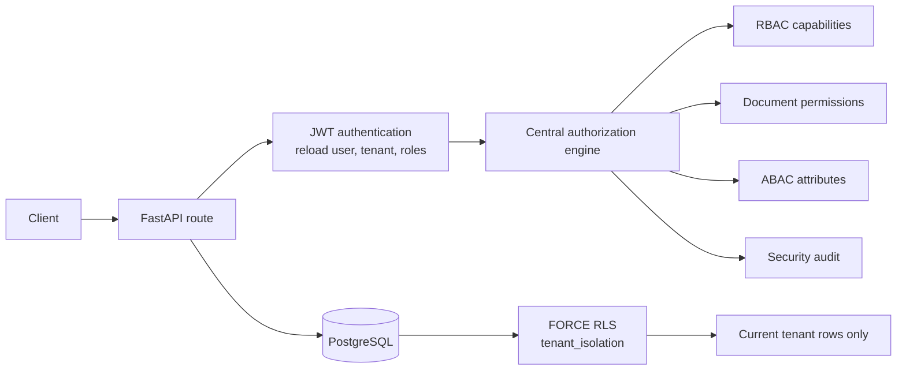

# VaultRAG — Permission-Aware Multi-Tenant RAG System

> **Milestone 2: RBAC, ABAC, Document Permissions, PostgreSQL RLS and Security Audit**

Multi-tenant platform where organizations share one application while users,
roles, documents and audit trails remain isolated.

This repository contains the **Milestone 2 backend**. Embeddings, vector search,
LLM calls, chatbot features and the frontend are deliberately out of scope.

Detailed threat model and design decisions: [docs/SECURITY.md](docs/SECURITY.md)

---

## What is included

- FastAPI, SQLAlchemy 2.0, PostgreSQL 16, Alembic
- Organization registration and tenant-owned roles:
  `ADMIN`, `HR`, `FINANCE`, `ENGINEERING`, `EMPLOYEE`
- Argon2id passwords and JWT authentication
- Authentication context reloaded from PostgreSQL on every request
- Centralized authorization engine (routes do not scatter role checks)
- Exact-match document permissions for roles or individual users
- Permission expiry, immediate soft revocation and grant history
- ABAC attributes: department, clearance level, employment status,
  location and designation
- Classification floors (`PUBLIC` 0, `INTERNAL` 1, `CONFIDENTIAL` 3,
  `RESTRICTED` 4)
- PostgreSQL `ENABLE` + `FORCE ROW LEVEL SECURITY`
- Restricted runtime DB role (`vaultrag_app`) and separate migrator role
  (`vaultrag_migrator`)
- Append-only security audit log with request-ID correlation
- **78 automated security tests**

---

## Architecture at a glance



Every document operation goes through
`app/services/authorization.py`. RBAC, ABAC, document grants and RLS are
separate controls that must all agree before data is returned.

---

## Quick start (Windows PowerShell)

```powershell
cd C:\Users\Madhurya\OneDrive\Desktop\VaultRag
python -m venv .venv
Set-ExecutionPolicy -Scope Process -ExecutionPolicy Bypass
.\.venv\Scripts\Activate.ps1
pip install -r backend\requirements.txt

docker compose up -d db
```

### 1. Create the database roles (once per database)

The API must not connect as a superuser or as the schema owner.

```powershell
Get-Content -Raw database\bootstrap_roles.sql | docker exec -i vaultrag-postgres psql -U vaultrag -d vaultrag -v app_password=vaultrag_app_local_dev_password -v migrator_password=vaultrag_migrator_local_dev_password -v ON_ERROR_STOP=1

Get-Content -Raw database\bootstrap_roles.sql | docker exec -i vaultrag-postgres psql -U vaultrag -d vaultrag_test -v app_password=vaultrag_app_local_dev_password -v migrator_password=vaultrag_migrator_local_dev_password -v ON_ERROR_STOP=1
```

Use strong, different passwords outside local development. If the Docker volume
already exists, `database/init.sql` will not run again; create the test database
manually and then run the role script for both databases.

### 2. Configure the environment

```powershell
cd backend
Copy-Item .env.example .env
python -c "import secrets; print(secrets.token_urlsafe(64))"
# Paste the output into JWT_SECRET_KEY in backend\.env
# Match the app/migrator passwords from step 1.
```

Key variables:

| Variable | Purpose |
|---|---|
| `DATABASE_URL` | Runtime API connection, `vaultrag_app` |
| `MIGRATION_DATABASE_URL` | Alembic connection, `vaultrag_migrator` |
| `TEST_DATABASE_URL` | Pytest runtime connection |
| `TEST_MIGRATION_DATABASE_URL` | Pytest schema/migration connection |
| `JWT_SECRET_KEY` | Token signing secret, at least 32 characters |

### 3. Apply migrations and start the API

```powershell
alembic upgrade head
uvicorn app.main:app --reload
```

- Swagger: <http://127.0.0.1:8000/docs>
- Health: <http://127.0.0.1:8000/health>

### 4. Run the tests

```powershell
cd C:\Users\Madhurya\OneDrive\Desktop\VaultRag\backend
pytest -q
```

Expected: `78 passed`.

The test suite drops and recreates the schema in the database configured by
`TEST_DATABASE_URL`. It refuses to run unless the database name contains
`test`.

---

## First administrator and ABAC bootstrap

There is no public endpoint that creates an administrator.

```powershell
$org = Invoke-RestMethod -Method Post `
  -Uri "http://127.0.0.1:8000/organizations/register" `
  -ContentType "application/json" `
  -Body (@{ organization_name = "TechNova" } | ConvertTo-Json)

python -m app.scripts.bootstrap_admin `
  --tenant-id $org.tenant_id `
  --username admin `
  --email admin@technova.com
```

The CLI prompts for the password securely. Public signup creates an **inactive,
role-less** account; an administrator must activate it and assign a role.

An administrator cannot raise their **own** clearance level. Bootstrap the first
administrator's ABAC attributes with a second administrator or an operator SQL
session:

1. Admin A creates Admin B with role `ADMIN`.
2. Admin B logs in and calls
   `PUT /users/{A}/attributes` with department, clearance and employment status.
3. Admin A logs in and sets Admin B's attributes.

Example body:

```json
{
  "attributes": {
    "department": "ADMIN",
    "clearance_level": "5",
    "employment_status": "ACTIVE"
  }
}
```

A user with no attributes is denied by ABAC. This is intentional fail-closed
behaviour, including for `ADMIN`.

---

## API

| Method | Path | Auth | Purpose |
|---|---|---|---|
| `POST` | `/organizations/register` | Public | Create tenant + default roles |
| `GET` | `/organizations/me` | Bearer | Current tenant |
| `POST` | `/auth/register` | Public | Pending signup |
| `POST` | `/auth/login` | Public | Email + password + tenant → JWT |
| `GET` | `/auth/me` | Bearer | Current identity + roles |
| `GET` | `/users` | ADMIN | List users in own tenant |
| `POST` | `/users` | ADMIN | Create user + assign roles |
| `GET` | `/users/{id}` | ADMIN | One user in own tenant |
| `POST` | `/users/{id}/roles` | ADMIN | Assign role |
| `DELETE` | `/users/{id}/roles/{role}` | ADMIN | Revoke role |
| `PATCH` | `/users/{id}/status` | ADMIN | Activate/deactivate |
| `GET` | `/users/{id}/attributes` | Self or ADMIN | Read ABAC attributes |
| `PUT` | `/users/{id}/attributes` | ADMIN | Create/update ABAC attributes |
| `POST` | `/documents` | ADMIN | Create document metadata |
| `GET` | `/documents` | Bearer | List documents the caller may READ |
| `GET` | `/documents/{id}` | Bearer | Read one authorized document |
| `GET` | `/documents/{id}/access-check?action=READ` | Bearer | Evaluate one action |
| `POST` | `/documents/{id}/permissions` | ADMIN or grantee | Grant exact action |
| `DELETE` | `/documents/{id}/permissions/{pid}` | ADMIN or grantee | Revoke permission |
| `GET` | `/security/audit-logs` | ADMIN | Tenant-scoped audit events |
| `GET` | `/health` | Public | Health check |

Login body:

```json
{
  "tenant_id": "<tenant-uuid>",
  "email": "admin@technova.com",
  "password": "SecurePassword123!"
}
```

JWT claims: `sub`, `tenant_id`, `roles`, `type`, `iat`, `exp`, `jti`.
In Swagger, click **Authorize** and paste the token.

---

## Authorization model

### RBAC — role capabilities

RBAC controls **administrative capabilities**, not document content:

| Capability | ADMIN | Other roles |
|---|---|---|
| `MANAGE_USERS` | yes | no |
| `MANAGE_ROLES` | yes | no |
| `CREATE_DOCUMENT` | yes | no |
| `MANAGE_ATTRIBUTES` | yes | no |
| `VIEW_AUDIT_LOGS` | yes | no |

ADMIN also has an implicit tenant-wide document capability for `READ`, `UPDATE`,
`DELETE` and `MANAGE_PERMISSIONS`. That bypass does **not** bypass ABAC:
clearance and employment checks still apply.

### Document permissions — exact action grants

A grant targets exactly one subject:

- a tenant-owned role (`role_id`), or
- one individual user (`user_id`).

Permission types are exact-match:

- `READ`
- `UPDATE`
- `DELETE`
- `MANAGE_PERMISSIONS`

`MANAGE_PERMISSIONS` does **not** imply `READ`, `UPDATE` or `DELETE`.
Permissions can expire, and revocation is soft (`is_active = false`,
`revoked_at` is set). Revocation is effective on the next request; the grant row
remains as history.

### ABAC — attributes evaluated at request time

ABAC answers: *may this user, right now, touch a document with these
attributes?*

Required attributes:

- `department`
- `clearance_level` (0–5)
- `employment_status` (`ACTIVE`, `INACTIVE`, `SUSPENDED`, `TERMINATED`)

Rules:

1. Missing or malformed attributes deny.
2. Employment status must be `ACTIVE`.
3. Department must match the document, unless the permission has
   `cross_department_allowed = true` or the caller is ADMIN.
4. Clearance must meet the document's required level.

Classification floors:

| Classification | Minimum clearance |
|---|---|
| `PUBLIC` | 0 |
| `INTERNAL` | 1 |
| `CONFIDENTIAL` | 3 |
| `RESTRICTED` | 4 |

A document cannot be created with a clearance requirement below its
classification floor.

### PostgreSQL RLS — database-enforced tenant isolation

- Both database roles are `NOSUPERUSER` and `NOBYPASSRLS`.
- `vaultrag_app` owns no tables and cannot run DDL.
- `vaultrag_migrator` owns the schema and runs Alembic.
- Every tenant table has `ENABLE` and `FORCE ROW LEVEL SECURITY`.
- The `tenant_isolation` policy applies to `PUBLIC` and uses
  `security.current_tenant_id()`.
- The API runs `set_config('app.current_tenant_id', :tenant_id, true)` at the
  start of each request transaction. The value is transaction-local and is
  cleared on commit or rollback, so it cannot leak through the connection pool.
- Missing or malformed context returns `NULL`; the policy denies all rows.

Application-level `tenant_id` filters remain as defence in depth.

### Central authorization engine

`app/services/authorization.py` evaluates, in order:

1. trusted user and organization state;
2. tenant match;
3. document active state and valid action;
4. RBAC / exact document permission;
5. ABAC department, employment and clearance.

Routes call the engine and translate the decision. They do not query
`document_permissions` or compare clearance levels directly.

---

## Security audit

- `security_audit_logs` is append-only for the runtime role: `SELECT` and
  `INSERT` only.
- Allowed decisions are written in the same transaction as the business action.
  If the audit write fails, the action is rolled back (fail closed).
- Denied authorization checks use an independent transaction so the denial
  survives the request rollback.
- Audit rows include tenant, actor, resource, action, decision, reason, policy,
  request ID and client IP.
- `GET /security/audit-logs` is ADMIN-only and tenant-scoped by both the query
  filter and RLS.
- Reading the audit log is itself audited.

---

## Test coverage

The suite covers:

- tenant creation, role catalogue and JWT lifecycle;
- tenant ID never accepted from query parameters, bodies or custom headers;
- cross-tenant user, document, permission and audit access (404 / empty);
- direct DB access with no context, wrong context and malformed context;
- `FORCE RLS` against the table owner;
- RLS context not leaking across pooled connections;
- missing, expired, revoked and inactive resources;
- `MANAGE_PERMISSIONS` not implying `READ`;
- department mismatch and explicit cross-department override;
- clearance floors, insufficient clearance and inactive employment;
- cross-tenant admin actions denied and audited;
- audit append-only enforcement and audit-failure rollback.

Required test files:

`test_rbac.py`, `test_abac.py`, `test_document_permissions.py`,
`test_rls.py`, `test_tenant_isolation.py`, `test_permission_revocation.py`,
`test_security_audit.py`.

---

## Known limitations

Not implemented in this milestone:

- document contents, ingestion, embeddings, vector search, LLM or chatbot;
- frontend;
- refresh tokens, token revocation list, email verification, invitations,
  password reset or MFA;
- login rate limiting or account lockout;
- a public endpoint for setting ABAC attributes on the first administrator;
- independent security audit or penetration test.

Never commit `backend/.env`, generated secrets or production database
credentials. This is an educational project following production patterns, but
it has not been independently security-audited.
