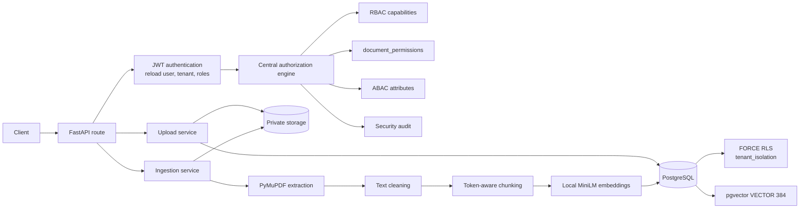
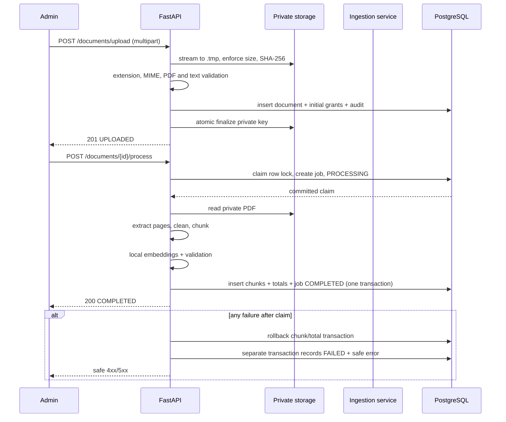

# VaultRAG — Permission-Aware Multi-Tenant RAG System

> **Milestone 3: Secure PDF ingestion, token-aware chunking, local embeddings and pgvector storage**

Multi-tenant platform where organizations share one application while users,
roles, documents, chunks, embeddings and audit trails remain isolated.

This repository contains the **Milestone 3 backend**. Retrieval, similarity
search, LLM calls, chatbot features and the frontend are deliberately out of
scope. Milestone 3 adds secure ingestion and vector-ready storage; it does not
expose a search endpoint.

Detailed threat model and design decisions: [docs/SECURITY.md](docs/SECURITY.md)

---

## What is included

### Milestone 1 — tenants, identity and RBAC

- FastAPI, SQLAlchemy 2.0, PostgreSQL 16, Alembic
- Organization registration and tenant-owned roles:
  `ADMIN`, `HR`, `FINANCE`, `ENGINEERING`, `EMPLOYEE`
- Argon2id passwords and JWT authentication
- Authentication context reloaded from PostgreSQL on every request
- Tenant-safe composite foreign keys

### Milestone 2 — authorization and audit

- Centralized authorization engine (routes do not scatter role checks)
- Exact-match document permissions for roles or individual users
- Permission expiry, immediate soft revocation and grant history
- ABAC attributes: department, clearance level, employment status,
  location and designation
- Classification floors (`PUBLIC` 0, `INTERNAL` 1, `CONFIDENTIAL` 3,
  `RESTRICTED` 4)
- PostgreSQL `ENABLE` + `FORCE ROW LEVEL SECURITY`
- Restricted runtime DB role (`vaultrag_app`) and separate migrator role
  (`vaultrag_migrator`)
- Append-only security audit log with request-ID correlation

### Milestone 3 — ingestion and vector-ready storage

- Multipart PDF upload with server-derived tenant, uploader, hash, storage key,
  processing status and permissions
- Private local storage behind a storage abstraction that can be replaced by a
  private S3-compatible backend later
- PyMuPDF validation and page-level text extraction
- Conservative text cleaning
- Token-aware sliding-window chunking with page-range tracking
- Local `sentence-transformers/all-MiniLM-L6-v2` embeddings (384 dimensions)
- pgvector `VECTOR(384)` storage
- Per-chunk security-metadata snapshots derived from authoritative document
  rows and current `document_permissions`
- Ingestion job tracking with concurrency guards and safe failure handling
- Upload, process, status and admin-only chunk-inspection APIs
- **136 automated tests**, including real PostgreSQL RLS/constraint tests and
  one real local embedding-model integration test

---

## Architecture at a glance



Every ordinary document operation flows through
`app/services/authorization.py`. RBAC, ABAC, document grants and RLS are
separate controls that must all agree before data is returned. Upload and
ingestion are administrative capabilities, but they still run inside the
authenticated tenant and every storage query is constrained by RLS.

---

## Quick start (Windows PowerShell)

```powershell
cd C:\Users\Madhurya\OneDrive\Desktop\VaultRag
python -m venv .venv
Set-ExecutionPolicy -Scope Process -ExecutionPolicy Bypass
.\.venv\Scripts\Activate.ps1
pip install -r backend\requirements.txt

docker compose up -d db
```

The development container is `pgvector/pgvector:pg16`, so PostgreSQL 16 and the
`vector` extension are available without a separate installation.

### 1. Create the database roles (once per database)

The API must not connect as a superuser or as the schema owner.

```powershell
Get-Content -Raw database\bootstrap_roles.sql | docker exec -i vaultrag-postgres psql -U vaultrag -d vaultrag -v app_password=vaultrag_app_local_dev_password -v migrator_password=vaultrag_migrator_local_dev_password -v ON_ERROR_STOP=1

Get-Content -Raw database\bootstrap_roles.sql | docker exec -i vaultrag-postgres psql -U vaultrag -d vaultrag_test -v app_password=vaultrag_app_local_dev_password -v migrator_password=vaultrag_migrator_local_dev_password -v ON_ERROR_STOP=1
```

`database/init.sql` runs only when the Docker volume is first created. If the
volume already exists, create the test database and install pgvector in both
databases manually:

```powershell
docker exec -it vaultrag-postgres psql -U vaultrag -d vaultrag -c "CREATE DATABASE vaultrag_test;"

docker exec -it vaultrag-postgres psql -U vaultrag -d vaultrag -c "CREATE SCHEMA IF NOT EXISTS extensions; CREATE EXTENSION IF NOT EXISTS vector SCHEMA extensions;"
docker exec -it vaultrag-postgres psql -U vaultrag -d vaultrag_test -c "CREATE SCHEMA IF NOT EXISTS extensions; CREATE EXTENSION IF NOT EXISTS vector SCHEMA extensions;"
```

pgvector intentionally lives in the `extensions` schema. The pytest fixture
drops and recreates `public` and `security`; keeping the extension in
`extensions` means `VECTOR(384)` survives the test-schema reset. Both database
roles receive `USAGE` on `extensions` and a `search_path` of
`public, extensions`.

### 2. Configure the environment

```powershell
cd backend
Copy-Item .env.example .env
python -c "import secrets; print(secrets.token_urlsafe(64))"
# Paste the output into JWT_SECRET_KEY in backend\.env
# Match the app/migrator passwords from step 1.
```

Core variables:

| Variable | Purpose |
|---|---|
| `DATABASE_URL` | Runtime API connection, `vaultrag_app` |
| `MIGRATION_DATABASE_URL` | Alembic connection, `vaultrag_migrator` |
| `TEST_DATABASE_URL` | Pytest runtime connection |
| `TEST_MIGRATION_DATABASE_URL` | Pytest schema/migration connection |
| `JWT_SECRET_KEY` | Token signing secret, at least 32 characters |

Milestone 3 ingestion variables:

| Variable | Default | Purpose |
|---|---|---|
| `DOCUMENT_STORAGE_DIR` | `private_documents` | Private local storage root. Never serve it publicly. |
| `MAX_UPLOAD_SIZE_BYTES` | `26214400` (25 MiB) | Maximum streamed PDF size. |
| `EMBEDDING_MODEL_NAME` | `sentence-transformers/all-MiniLM-L6-v2` | Local model name. |
| `EMBEDDING_MODEL_VERSION` | `main` | Version label stored with documents/chunks. |
| `EMBEDDING_DIMENSION` | `384` | Must remain 384 because the DB column is `VECTOR(384)`. |
| `EMBEDDING_BATCH_SIZE` | `32` | Embedding batch size. |
| `EMBEDDING_DEVICE` | `cpu` | Sentence Transformers device. |
| `CHUNK_SIZE_TOKENS` | `500` | Target chunk size. |
| `CHUNK_OVERLAP_TOKENS` | `100` | Token overlap between windows. |
| `CHUNK_MIN_TOKENS` | `50` | Minimum trailing chunk size (except a short document). |
| `CHUNK_MAX_TOKENS` | `700` | Hard upper bound. |
| `PDF_MIN_EXTRACTABLE_CHARS` | `50` | Below this, a PDF is treated as image-only. |

Settings validation rejects an embedding dimension other than 384 and enforces
`CHUNK_MIN_TOKENS <= CHUNK_SIZE_TOKENS <= CHUNK_MAX_TOKENS` and
`CHUNK_OVERLAP_TOKENS < CHUNK_SIZE_TOKENS`.

### 3. Apply migrations and start the API

```powershell
alembic upgrade head
uvicorn app.main:app --reload
```

- Swagger: <http://127.0.0.1:8000/docs>
- Health: <http://127.0.0.1:8000/health>

### 4. Run the tests

```powershell
cd C:\Users\Madhurya\OneDrive\Desktop\VaultRag\backend
pytest -q
```

Expected: `136 passed`.

The test suite drops and recreates the schema in the database configured by
`TEST_DATABASE_URL`. It refuses to run unless the database name contains
`test`. Tests run application traffic as `vaultrag_app` (NOSUPERUSER,
NOBYPASSRLS) and migrations as `vaultrag_migrator`, so RLS is exercised through
the real privilege boundary.

The first real-model test downloads/caches
`sentence-transformers/all-MiniLM-L6-v2` (roughly 90 MB). Later runs use the
Hugging Face cache. Most tests inject deterministic fake embeddings and never
load Torch.

---

## First administrator and ABAC bootstrap

There is no public endpoint that creates an administrator.

```powershell
$org = Invoke-RestMethod -Method Post `
  -Uri "http://127.0.0.1:8000/organizations/register" `
  -ContentType "application/json" `
  -Body (@{ organization_name = "TechNova" } | ConvertTo-Json)

python -m app.scripts.bootstrap_admin `
  --tenant-id $org.tenant_id `
  --username admin `
  --email admin@technova.com
```

The CLI prompts for the password securely. Public signup creates an **inactive,
role-less** account; an administrator must activate it and assign a role.

An administrator cannot raise their **own** clearance level. Bootstrap the first
administrator's ABAC attributes with a second administrator or an operator SQL
session:

1. Admin A creates Admin B with role `ADMIN`.
2. Admin B logs in and calls
   `PUT /users/{A}/attributes` with department, clearance and employment status.
3. Admin A logs in and sets Admin B's attributes.

Example body:

```json
{
  "attributes": {
    "department": "ADMIN",
    "clearance_level": "5",
    "employment_status": "ACTIVE"
  }
}
```

A user with no attributes is denied by ABAC. This is intentional fail-closed
behaviour, including for `ADMIN`. Upload and ingestion capabilities are
administrative, but document reads, permission changes, status reads and
admin chunk inspection still go through the central authorization engine and
its ABAC checks.

---

## API

| Method | Path | Auth | Purpose |
|---|---|---|---|
| `POST` | `/organizations/register` | Public | Create tenant + default roles |
| `GET` | `/organizations/me` | Bearer | Current tenant |
| `POST` | `/auth/register` | Public | Pending signup |
| `POST` | `/auth/login` | Public | Email + password + tenant → JWT |
| `GET` | `/auth/me` | Bearer | Current identity + roles |
| `GET` | `/users` | ADMIN | List users in own tenant |
| `POST` | `/users` | ADMIN | Create user + assign roles |
| `GET` | `/users/{id}` | ADMIN | One user in own tenant |
| `POST` | `/users/{id}/roles` | ADMIN | Assign role |
| `DELETE` | `/users/{id}/roles/{role}` | ADMIN | Revoke role |
| `PATCH` | `/users/{id}/status` | ADMIN | Activate/deactivate |
| `GET` | `/users/{id}/attributes` | Self or ADMIN | Read ABAC attributes |
| `PUT` | `/users/{id}/attributes` | ADMIN | Create/update ABAC attributes |
| `POST` | `/documents` | ADMIN | Create legacy metadata-only document |
| `POST` | `/documents/upload` | ADMIN (`CREATE_DOCUMENT`) | Upload a PDF to private storage |
| `POST` | `/documents/{id}/process` | ADMIN (`PROCESS_DOCUMENT`) | Extract, chunk, embed and store |
| `GET` | `/documents/{id}/status` | Bearer with `READ` | Ingestion status and latest job |
| `GET` | `/documents/{id}/chunks` | ADMIN (`VIEW_CHUNKS` + document `READ`) | Inspect stored chunks and metadata |
| `GET` | `/documents` | Bearer | List documents the caller may `READ` |
| `GET` | `/documents/{id}` | Bearer | Read one authorized document |
| `GET` | `/documents/{id}/access-check?action=READ` | Bearer | Evaluate one action |
| `POST` | `/documents/{id}/permissions` | ADMIN or grantee | Grant exact action |
| `DELETE` | `/documents/{id}/permissions/{pid}` | ADMIN or grantee | Revoke permission |
| `GET` | `/security/audit-logs` | ADMIN | Tenant-scoped audit events |
| `GET` | `/health` | Public | Health check |

Login body:

```json
{
  "tenant_id": "<tenant-uuid>",
  "email": "admin@technova.com",
  "password": "SecurePassword123!"
}
```

JWT claims: `sub`, `tenant_id`, `roles`, `type`, `iat`, `exp`, `jti`.
In Swagger, click **Authorize** and paste the token.

### Upload

`POST /documents/upload` accepts **multipart form data** only:

| Form field | Required | Notes |
|---|---|---|
| `document_name` | yes | 1–255 characters |
| `department` | yes | Must be an allowed server-side department |
| `classification` | yes | `PUBLIC`, `INTERNAL`, `CONFIDENTIAL` or `RESTRICTED` |
| `file` | yes | A `.pdf` with an allowed PDF content type |

```powershell
curl.exe -X POST "http://127.0.0.1:8000/documents/upload" `
  -H "Authorization: Bearer $TOKEN" `
  -F "document_name=Security Policy" `
  -F "department=ENGINEERING" `
  -F "classification=INTERNAL" `
  -F "file=@policy.pdf;type=application/pdf"
```

The server derives, and never accepts from the client:

- `tenant_id`
- `uploaded_by`
- `file_hash`
- `file_size`
- `storage_path`
- `processing_status`
- `total_pages`, `total_chunks`, `embedding_model`
- initial permission grants
- `is_active` and document type

Unknown form fields are ignored; the service never reads security metadata from
the request. A successful upload returns `201` with
`processing_status = "UPLOADED"`.

Upload validation includes:

- filename extension `.pdf`;
- declared content type in the PDF allowlist;
- streamed size limit and non-empty file;
- real PDF content, not a renamed text file;
- not encrypted or password-protected;
- at least one page;
- extractable text above `PDF_MIN_EXTRACTABLE_CHARS`;
- tenant-scoped duplicate SHA-256 check.

Encrypted, malformed and image-only PDFs are rejected at upload with safe
`422` errors. A duplicate hash in the same tenant returns `409`; the same bytes
may exist in another tenant.

### Process

`POST /documents/{id}/process` runs synchronously in this milestone:

- only `ADMIN` has `PROCESS_DOCUMENT`;
- the document must belong to the caller's tenant (RLS);
- only `UPLOADED` or `FAILED` documents are processable;
- the document must have a private stored file;
- an active `PENDING`/`PROCESSING` job blocks a second run;
- a document with existing chunks cannot be reprocessed without cleanup;
- `COMPLETED` and `ARCHIVED` documents return `409`.

The response is the same status shape as `GET /documents/{id}/status`.

### Status

`GET /documents/{id}/status` requires ordinary document `READ` authorization
and returns:

```json
{
  "document_id": "...",
  "processing_status": "COMPLETED",
  "total_pages": 6,
  "total_chunks": 2,
  "embedding_model": "sentence-transformers/all-MiniLM-L6-v2@main",
  "file_size": 123456,
  "job_id": "...",
  "job_status": "COMPLETED",
  "error_code": null,
  "error_message": null,
  "started_at": "...",
  "completed_at": "...",
  "updated_at": "..."
}
```

Failures expose only a stable error code and safe message. Extracted text and
exception internals are never written to the job row.

### Chunk inspection

`GET /documents/{id}/chunks` is an **admin-only debug endpoint** guarded by
`VIEW_CHUNKS` and normal document `READ` authorization (including ABAC). It
returns chunks ordered by `chunk_index`, including `chunk_text`, page range and
the JSONB metadata snapshot. It deliberately does **not** return the embedding
vector.

The endpoint is intended for ingestion verification, not for production search.
Retrieval and similarity search are out of scope for this milestone.

### Document response extension

`GET /documents` and `GET /documents/{id}` now include:

- `file_hash`
- `file_size`
- `processing_status`
- `total_pages`
- `total_chunks`
- `embedding_model`

`storage_path` is intentionally never exposed through the API.

Legacy Milestone 2 metadata-only documents remain readable, but they cannot be
processed because they have no stored file. `/documents/{id}/process` returns
`422` for them.

---

## Ingestion workflow



### Transaction boundaries

1. **Claim** — lock the document row with `SELECT ... FOR UPDATE`, reject
   inactive/unprocessable documents and active jobs, create a `PROCESSING` job,
   set the document to `PROCESSING`, audit `INGESTION_START`, commit. The claim
   is committed before expensive parsing/embedding so a second request sees the
   active job.
2. **Process** — outside any long transaction: validate the private file, extract
   pages, clean text, chunk, embed and build the permission snapshot. No database
   locks are held during CPU-heavy work.
3. **Finalise** — one transaction inserts every chunk, updates
   `total_pages`, `total_chunks`, `embedding_model`, sets the document
   `COMPLETED`, marks the job `COMPLETED`, and audits `INGESTION_COMPLETE`.
   Chunks and status therefore commit or roll back together.
4. **Failure** — the finalise transaction rolls back. A separate short
   transaction sets the document/job to `FAILED`, stores a safe error code and
   message, resets totals to zero, and audits `INGESTION_FAIL`. A document is
   never left `COMPLETED` with a partial chunk set.

### Concurrency and reprocessing

Two guards prevent concurrent processing:

- a row lock during claim;
- a partial unique index on `document_ingestion_jobs (tenant_id, document_id)`
  where `status IN ('PENDING', 'PROCESSING')`.

A second claim receives `409 Conflict`. This is tested with two overlapping
service calls: one blocks inside embedding generation while the second is
rejected.

Reprocessing is allowed only from `UPLOADED` or `FAILED` and only when no chunks
exist. Completed and archived documents are rejected. This milestone does not
provide a cleanup endpoint for deleting old chunks.

### Status model

`documents.processing_status`:

- `UPLOADED` — file stored, waiting for processing;
- `PROCESSING` — an active job owns the document;
- `COMPLETED` — all chunks, totals and job state committed;
- `FAILED` — safe failure recorded; retry is allowed;
- `ARCHIVED` — not processable in this milestone.

`document_ingestion_jobs.status`: `PENDING`, `PROCESSING`, `COMPLETED`,
`FAILED`.

---

## PDF validation and extraction

Implemented in `app/services/document_processor.py` with PyMuPDF.

- Opens with `filetype="pdf"`; PyMuPDF exceptions become
  `MALFORMED_PDF`.
- Requires `document.is_pdf`, at least one page, and a loadable first page.
- Rejects `needs_pass` / `is_encrypted` PDFs with
  `ENCRYPTED_PDF_UNSUPPORTED`.
- Extracts page by page with `page.get_text("text", sort=True)`, preserving the
  original 1-based page number.
- Records empty pages without inventing text.
- Counts non-whitespace characters. Below
  `PDF_MIN_EXTRACTABLE_CHARS` (default 50), the PDF is treated as image-only and
  fails with `OCR_UNSUPPORTED`.
- Missing files and malformed/truncated PDFs fail with safe codes.
- Extracted text is never logged.

Upload performs the extraction once for early validation and then discards the
text. Processing re-extracts from the private file. This costs CPU but gives
immediate feedback and prevents image-only files from entering the queue.

OCR is not implemented. Scanned/image-only PDFs are rejected rather than
silently stored with empty embeddings.

---

## Text cleaning

Implemented in `app/services/text_cleaner.py`. The cleaner is deliberately
conservative:

1. normalize `\r\n` and `\r` to `\n`;
2. remove zero-width characters;
3. replace non-breaking spaces;
4. collapse horizontal whitespace runs to one space;
5. trim leading/trailing whitespace on each line;
6. collapse three or more newlines to one paragraph break;
7. trim the outer result.

It does not remove punctuation, numbers, dates, identifiers, currency amounts
or technical terms, because those can change document meaning. Empty pages are
skipped. If no meaningful text remains, ingestion fails with
`TEXT_CLEANING_FAILED`.

---

## Chunking

Implemented in `app/services/chunking.py`.

- Uses the embedding model's tokenizer, not character counts.
- Builds a token stream annotated with the source page number.
- Sliding window defaults: **500 tokens**, **100 overlap**, minimum **50**,
  maximum **700**.
- Window step is `chunk_size_tokens - chunk_overlap_tokens`.
- Decodes each window back to text and records the minimum/maximum page number
  of its tokens as `page_start` / `page_end`.
- Chunks are ordered by `chunk_index` and preserve logical document order.
- A tiny trailing window is rebuilt backwards to the configured minimum where
  possible. A document shorter than the minimum produces one chunk rather than
  dropping content.
- Empty/whitespace-only documents fail with `NO_CHUNKS_GENERATED`.
- Page separators are included only when the tokenizer represents newlines as
  tokens; page metadata remains exact either way.

Before any row is inserted, `validate_chunk_batch` checks:

- non-empty chunk list and matching embedding count;
- active parent document and complete identity;
- positive page count;
- sequential, unique chunk indexes;
- non-empty text;
- `1 <= page_start <= page_end <= total_pages`;
- exact embedding dimension and finite values;
- metadata keys and values match the authoritative document and snapshot.

---

## Embeddings

Implemented in `app/services/embedding_service.py`.

- Local `sentence-transformers/all-MiniLM-L6-v2`.
- Configurable model name, version label, batch size and device; default CPU.
- 384 dimensions, matching `document_chunks.embedding VECTOR(384)`.
- Lazy model load, one process-wide instance.
- `normalize_embeddings=True`, batched inference, no external API.
- Validates output shape, exact dimension and finite values; NaN/Infinity raise
  `INVALID_EMBEDDING`.
- Stores the model label (`<model>@<version>`) on the document and the
  model/version fields in every chunk metadata snapshot.

Tests use a deterministic fake embedding service for speed. One integration
test loads the real local MiniLM model and verifies 384 finite, normalized
values. The first real run downloads the model into the Hugging Face cache.

---

## Private storage security

Implemented in `app/services/storage.py`.

- Development implementation: `LocalPrivateStorage`.
- Configurable root: `DOCUMENT_STORAGE_DIR`, default `private_documents`.
- Generated keys only: `<tenant_uuid>/<document_uuid_hex>.pdf`.
- The original filename is never used as a path.
- Absolute paths, drive letters, NUL bytes and `..` segments are rejected.
- Resolved paths must remain under the private root.
- Uploads stream into a private `.tmp` directory while enforcing
  `MAX_UPLOAD_SIZE_BYTES`; the size is checked incrementally.
- SHA-256 is computed during streaming.
- Finalization uses `os.replace` for an atomic move on the same filesystem.
- On POSIX, the final file is chmod `0600`; on Windows the directory stays
  private and the API never serves it.
- On database commit failure, the final file is deleted. On storage
  finalization failure, the database transaction is rolled back.
- Temporary files are always removed in `finally`.
- `storage_path` is never included in API responses.
- `.gitignore` excludes `private_documents/` and test storage patterns.

The `PrivateStorage` protocol is intentionally small (`build_key`,
`save_stream`, `finalize`, `delete_key`, `delete_path`, `path_for`, `exists`) so
a private S3-compatible implementation can replace the local backend without
changing upload or ingestion logic.

**Deployment requirement:** never mount or proxy `DOCUMENT_STORAGE_DIR` as a
static/public directory. Configure reverse-proxy request-size limits as
defence in depth.

---

## Security metadata on every chunk

Built by `app/services/chunk_metadata.py`; validated by
`app/services/chunk_storage.py`.

Every chunk inherits from authoritative server-side records:

- `tenant_id`, `document_id`
- `department`, `classification`, `required_clearance_level`
- `allowed_roles` — current active, unexpired `READ` grants by role
- `allowed_role_ids`
- `allowed_user_ids` — direct user grants
- `permission_snapshot_at`
- `embedding_model`, `embedding_model_version`

The JSONB metadata is a **snapshot only**, not an authorization source of
truth. Revoking a grant after ingestion does not rewrite historical chunks.
Future retrieval must recheck the current `document_permissions` through the
central authorization engine. This is explicitly tested: after revocation the
stored chunk snapshot still contains the old role while a live snapshot no
longer does.

Additional protections:

- metadata keys are allowlisted; unexpected privileged keys fail validation;
- metadata is compared field-by-field with the document and snapshot before
  insert;
- tenant isolation is enforced by RLS and a composite
  `(tenant_id, document_id)` foreign key;
- chunk indexes are unique per document;
- the runtime role receives `SELECT, INSERT` on chunks only (no application
  update/delete path in this milestone).

---

## Initial permissions on upload

The upload service derives initial grants server-side:

- `ADMIN` role: `READ` + `MANAGE_PERMISSIONS` when the tenant role exists;
- the document's department role: `READ` when that tenant role exists and is
  not `ADMIN`;
- no direct grant to the uploader;
- duplicate-safe inserts inside savepoints;
- each grant is audited.

A department of `ADMIN` does not create a duplicate second grant. The uploader
does not receive unrestricted access merely by uploading.

---

## Database schema

Migration: `1f07b971535a_milestone3_ingestion_schema.py`
(base: `9d4e6f8a1b2c`).

### `documents` (extended)

| Column | Type | Notes |
|---|---|---|
| `file_hash` | `VARCHAR(64)` | Lowercase SHA-256, nullable for legacy rows |
| `storage_path` | `TEXT` | Private generated key, never exposed |
| `file_size` | `BIGINT` | Streamed byte count |
| `processing_status` | `VARCHAR(20)` | `UPLOADED`, `PROCESSING`, `COMPLETED`, `FAILED`, `ARCHIVED` |
| `total_pages` | `INTEGER` | `>= 0` |
| `total_chunks` | `INTEGER` | `>= 0` |
| `embedding_model` | `VARCHAR(255)` | `<model>@<version>` |

Constraints include processing-status membership, file-size/page/chunk
non-negativity, SHA-256 format, non-blank storage path, and a tenant-scoped
partial unique index on `(tenant_id, file_hash)` where `file_hash IS NOT NULL`.

### `document_chunks`

| Column | Type | Notes |
|---|---|---|
| `chunk_id` | `UUID` | Primary key |
| `tenant_id` | `UUID` | FK to organizations |
| `document_id` | `UUID` | Composite FK with tenant |
| `chunk_index` | `INTEGER` | `>= 0` |
| `chunk_text` | `TEXT` | Non-blank |
| `embedding` | `VECTOR(384)` | pgvector |
| `page_start`, `page_end` | `INTEGER` | `page_start >= 1`, `page_end >= page_start` |
| `metadata` | `JSONB` | Trusted snapshot; ORM attribute `chunk_metadata` |
| `created_at` | `TIMESTAMPTZ` | Server default |

Constraints and indexes:

- direct tenant FK to `organizations`;
- composite FK `(tenant_id, document_id)` to
  `documents(tenant_id, document_id)` with `ON DELETE CASCADE`;
- unique `(tenant_id, document_id, chunk_index)`;
- index `(tenant_id, document_id)`;
- GIN index on `metadata`.

### `document_ingestion_jobs`

| Column | Type | Notes |
|---|---|---|
| `job_id` | `UUID` | Primary key |
| `tenant_id`, `document_id` | `UUID` | Composite FK to documents |
| `status` | `VARCHAR(20)` | `PENDING`, `PROCESSING`, `COMPLETED`, `FAILED` |
| `started_at`, `completed_at` | `TIMESTAMPTZ` | Nullable |
| `error_code` | `VARCHAR(64)` | Stable safe code |
| `error_message` | `TEXT` | Safe message, no text content |
| `pages_processed`, `chunks_created`, `retry_count` | `INTEGER` | `>= 0` |

The partial unique index
`uq_ingestion_jobs_active_document (tenant_id, document_id) WHERE status IN
('PENDING', 'PROCESSING')` is the database-level concurrency guard.

### RLS, grants and pgvector

- `document_chunks` and `document_ingestion_jobs` have `ENABLE` + `FORCE ROW
  LEVEL SECURITY` and the same fail-closed `tenant_isolation` policy as the
  Milestone 2 tables.
- `vaultrag_app` receives `SELECT, INSERT` on chunks and `SELECT, INSERT, UPDATE`
  on ingestion jobs. It owns no tables and cannot run DDL.
- pgvector is installed in the `extensions` schema; the runtime and migrator
  roles have `USAGE` and a `search_path` that includes it.
- Application-level tenant filters remain as defence in depth.

---

## Authorization model

### RBAC — role capabilities

RBAC controls **administrative capabilities**, not ordinary document content:

| Capability | ADMIN | Other roles |
|---|---|---|
| `MANAGE_USERS` | yes | no |
| `MANAGE_ROLES` | yes | no |
| `CREATE_DOCUMENT` | yes | no |
| `PROCESS_DOCUMENT` | yes | no |
| `VIEW_CHUNKS` | yes | no |
| `MANAGE_ATTRIBUTES` | yes | no |
| `VIEW_AUDIT_LOGS` | yes | no |

ADMIN also has an implicit tenant-wide document capability for `READ`, `UPDATE`,
`DELETE` and `MANAGE_PERMISSIONS`. That bypass does **not** bypass ABAC:
clearance and employment checks still apply. Non-admin role capability sets are
empty; their document access comes from `document_permissions`.

### Document permissions — exact action grants

A grant targets exactly one subject:

- a tenant-owned role (`role_id`), or
- one individual user (`user_id`).

Permission types are exact-match:

- `READ`
- `UPDATE`
- `DELETE`
- `MANAGE_PERMISSIONS`

`MANAGE_PERMISSIONS` does **not** imply `READ`, `UPDATE` or `DELETE`.
Permissions can expire, and revocation is soft (`is_active = false`,
`revoked_at` is set). Revocation is effective on the next request; the grant row
remains as history.

### ABAC — attributes evaluated at request time

ABAC answers: *may this user, right now, touch a document with these
attributes?*

Required attributes:

- `department`
- `clearance_level` (0–5)
- `employment_status` (`ACTIVE`, `INACTIVE`, `SUSPENDED`, `TERMINATED`)

Rules:

1. Missing or malformed attributes deny.
2. Employment status must be `ACTIVE`.
3. Department must match the document, unless the permission has
   `cross_department_allowed = true` or the caller is ADMIN.
4. Clearance must meet the document's required level.

Classification floors:

| Classification | Minimum clearance |
|---|---|
| `PUBLIC` | 0 |
| `INTERNAL` | 1 |
| `CONFIDENTIAL` | 3 |
| `RESTRICTED` | 4 |

A document cannot be created with a clearance requirement below its
classification floor.

### PostgreSQL RLS — database-enforced tenant isolation

- Both database roles are `NOSUPERUSER` and `NOBYPASSRLS`.
- `vaultrag_app` owns no tables and cannot run DDL.
- `vaultrag_migrator` owns the schema and runs Alembic.
- Every tenant table has `ENABLE` and `FORCE ROW LEVEL SECURITY`.
- The `tenant_isolation` policy applies to `PUBLIC` and uses
  `security.current_tenant_id()`.
- The API runs `set_config('app.current_tenant_id', :tenant_id, true)` at the
  start of each request transaction. The value is transaction-local and is
  cleared on commit or rollback, so it cannot leak through the connection pool.
- Missing or malformed context returns `NULL`; the policy denies all rows.

Application-level `tenant_id` filters remain as defence in depth.

### Central authorization engine

`app/services/authorization.py` evaluates, in order:

1. trusted user and organization state;
2. tenant match;
3. document active state and valid action;
4. RBAC / exact document permission;
5. ABAC department, employment and clearance.

Routes call the engine and translate the decision. They do not query
`document_permissions` or compare clearance levels directly.

---

## Security audit

- `security_audit_logs` is append-only for the runtime role: `SELECT` and
  `INSERT` only.
- Allowed decisions are written in the same transaction as the business action.
  If the audit write fails, the action is rolled back (fail closed).
- Denied authorization checks use an independent transaction so the denial
  survives the request rollback.
- Ingestion writes `INGESTION_START`, `INGESTION_COMPLETE` and `INGESTION_FAIL`
  audit events with safe reasons only.
- Upload writes `UPLOAD` and initial `PERMISSION_GRANT` events.
- Admin chunk inspection writes `CHUNKS_VIEW`.
- Audit rows include tenant, actor, resource, action, decision, reason, policy,
  request ID and client IP.
- `GET /security/audit-logs` is ADMIN-only and tenant-scoped by both the query
  filter and RLS.
- Reading the audit log is itself audited.

---

## Repository layout

```text
backend/
  alembic/versions/
    1f07b971535a_milestone3_ingestion_schema.py
  app/
    core/               config, database, security constants, exceptions
    dependencies/       authentication and capability dependencies
    models/             Organization, User, Role, Document,
                        DocumentPermission, DocumentChunk,
                        DocumentIngestionJob, SecurityAuditLog
    routes/             auth, users, organizations, documents, audit
    schemas/            Pydantic request/response models
    services/
      authorization.py  central RBAC/ABAC engine
      document_upload.py
      storage.py
      document_processor.py
      text_cleaner.py
      chunking.py
      embedding_service.py
      chunk_metadata.py
      chunk_storage.py
      ingestion_service.py
    tests/
      test_document_upload.py
      test_pdf_extraction.py
      test_text_cleaning.py
      test_chunking.py
      test_embeddings.py
      test_chunk_metadata.py
      test_chunk_storage.py
      test_ingestion_pipeline.py
      test_ingestion_security.py
      test_rbac.py
      test_abac.py
      test_document_permissions.py
      test_permission_revocation.py
      test_rls.py
      test_tenant_isolation.py
      test_security_audit.py
      test_auth.py
      test_organizations.py
database/
  init.sql              databases + pgvector in extensions schema
  bootstrap_roles.sql   restricted app role + migrator role
docs/
  SECURITY.md
```

---

## Test coverage

Current result: **136 passed**.

Milestone 3 test files and coverage:

| File | Coverage |
|---|---|
| `test_document_upload.py` | valid upload, private storage, server-derived metadata, mass-assignment resistance, extension/MIME/empty/malformed/encrypted/image-only rejection, duplicate hash per tenant, initial grants, storage size limit/traversal |
| `test_pdf_extraction.py` | real PyMuPDF files, page ordering/empty pages, renamed non-PDF, encrypted, image-only, blank, missing and truncated files |
| `test_text_cleaning.py` | line endings, zero-width characters, horizontal whitespace, paragraph preservation, punctuation/numbers |
| `test_chunking.py` | token limits, overlap, page ranges across boundaries, short documents, trailing-window rebuild, empty input, config validation |
| `test_embeddings.py` | fake vectors, wrong dimension, NaN/Infinity, empty batch, real local MiniLM 384-dimension normalized output |
| `test_chunk_metadata.py` | snapshot from active READ grants, trusted fields, mismatch rejection, stale snapshot after grant/revoke |
| `test_chunk_storage.py` | transactional insert, tenant inheritance, validation, wrong dimension/non-finite, page/index errors, metadata extra keys, rollback on constraint failure, composite-FK cross-tenant insertion, RLS rejection |
| `test_ingestion_pipeline.py` | end-to-end process, status/list/chunks APIs, missing file failure, rollback failure, concurrent processing rejection, metadata-only document rejection |
| `test_ingestion_security.py` | non-admin upload/process/chunks denial, admin-without-ABAC chunk denial, authorized non-admin status, cross-tenant 404, debug endpoint denial, stale permission snapshot, archived document rejection |

The suite uses **real PostgreSQL** for RLS, composite foreign keys, partial
unique indexes and pgvector. Embeddings are mocked for fast unit/API tests; one
test uses the real local Sentence Transformers model. No test claims a feature
works without asserting the database state or API response.

Useful commands:

```powershell
cd backend
pytest -q
alembic check
```

---

## Known limitations

Not implemented in this milestone:

- retrieval, similarity search, citation building, LLM calls, chatbot or
  frontend;
- a background worker/queue: processing is synchronous and the HTTP request
  blocks during extraction/embedding;
- private S3 storage: only the local storage implementation exists, although
  the protocol is designed for a later adapter;
- OCR for scanned/image-only PDFs;
- malware/virus scanning, document sandboxing beyond PyMuPDF parsing, or
  CPU/memory quotas per document;
- cleanup/reprocessing API: completed documents cannot be reprocessed, and old
  chunks have no delete path;
- re-embedding or model-version migration tooling;
- chunk-listing pagination: the admin debug endpoint returns all chunks;
- retrieval-time permission enforcement: retrieval is out of scope, so the
  JSONB snapshot is not used as an authorization source;
- application-level encryption of files at rest (rely on OS/disk permissions
  and encryption);
- refresh tokens, token revocation list, email verification, invitations,
  password reset or MFA;
- login rate limiting or account lockout;
- a public endpoint for setting ABAC attributes on the first administrator;
- independent security audit or penetration test.

Never commit `backend/.env`, generated secrets, private documents or production
database credentials. This is an educational project following production
patterns, but it has not been independently security-audited.
