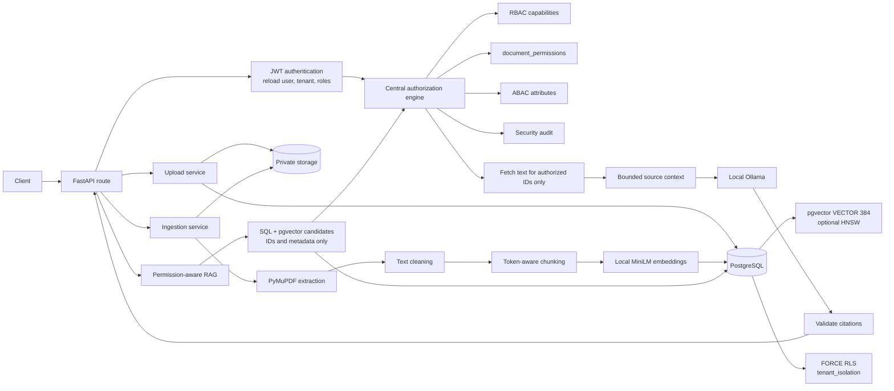
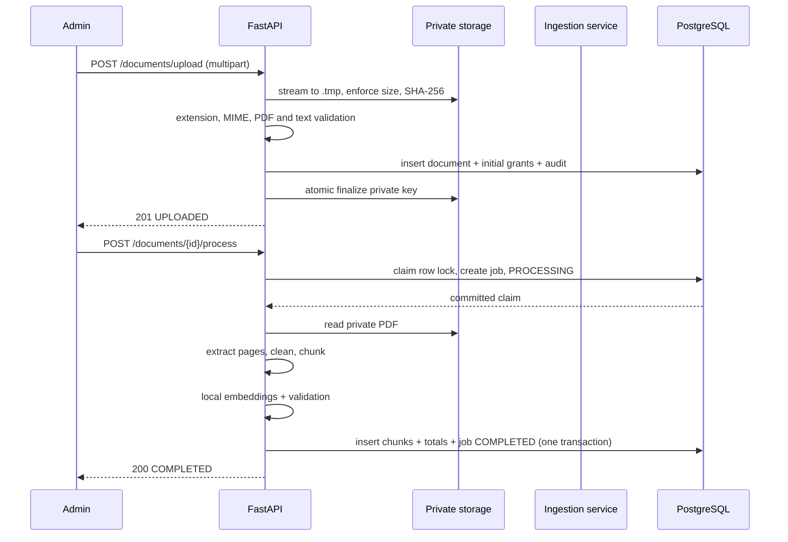

# VaultRAG - Permission-Aware Multi-Tenant RAG Platform

> **Milestones 1-5: tenant-isolated authorization, ingestion, permission-aware RAG, and a full-stack employee/admin/security interface**

VaultRAG is a multi-tenant platform where organizations share one application
while users, roles, documents, chunks, embeddings, retrieval context, generated
answers and audit trails remain isolated.

This repository contains a FastAPI/PostgreSQL backend and the Milestone 5 React frontend. The backend provides:

- a permission-aware retrieval pipeline over the Milestone 3 pgvector chunks;
- local generation through Ollama, with no paid LLM API;
- backend-generated source identifiers and citation validation;
- security audit events for retrieval, generation and citation decisions;
- an optional HNSW vector index, benchmarked before inclusion.

Milestone 5 adds the responsive employee workspace, AI assistant, document
management, user and role directory, and tenant-scoped security monitoring.
The frontend is documented in [frontend/README.md](frontend/README.md). A
production background-worker queue remains out of scope.

**Primary security guarantee:** unauthorized document chunk text is never
selected for context construction and is never sent to the language model.

Detailed threat model and design decisions: [docs/SECURITY.md](docs/SECURITY.md)

---

## What is included

### Milestone 1 - tenants, identity and RBAC

- FastAPI, SQLAlchemy 2.0, PostgreSQL 16 and Alembic
- Organization registration and tenant-owned roles:
  `ADMIN`, `HR`, `FINANCE`, `ENGINEERING`, `EMPLOYEE`
- Argon2id passwords and JWT authentication
- Authentication context reloaded from PostgreSQL on every request
- Tenant-safe composite foreign keys

### Milestone 2 - authorization and audit

- Centralized authorization engine (routes do not scatter role checks)
- Exact-match document permissions for roles or individual users
- Permission expiry, immediate soft revocation and grant history
- ABAC attributes: department, clearance level, employment status,
  location and designation
- Classification floors (`PUBLIC` 0, `INTERNAL` 1, `CONFIDENTIAL` 3,
  `RESTRICTED` 4)
- PostgreSQL `ENABLE` + `FORCE ROW LEVEL SECURITY`
- Restricted runtime DB role (`vaultrag_app`) and separate migrator role
  (`vaultrag_migrator`)
- Append-only security audit log with request-ID correlation

### Milestone 3 - ingestion and vector-ready storage

- Multipart PDF upload with server-derived tenant, uploader, hash, storage key,
  processing status and permissions
- Private local storage behind a replaceable storage abstraction
- PyMuPDF validation and page-level extraction
- Conservative text cleaning
- Token-aware sliding-window chunking with page-range tracking
- Local `sentence-transformers/all-MiniLM-L6-v2` embeddings (384 dimensions)
- pgvector `VECTOR(384)` storage
- Ingestion jobs with concurrency guards and safe failure handling
- Upload, process, status and admin-only chunk-inspection APIs

### Milestone 4 - permission-aware RAG

- `POST /rag/ask` with a strict request schema that rejects `tenant_id`
- Three-stage retrieval:
  1. SQL/pgvector candidate search selects IDs and metadata only;
  2. current RBAC/ABAC/document permissions authorize each candidate;
  3. text is fetched only for authorized chunk IDs.
- Tenant filtering in SQL and PostgreSQL RLS on every retrieval query
- Matching embedding-model label enforced in SQL, so vectors from different
  embedding spaces are never mixed
- Current `document_permissions` checks, including expiry and revocation, on
  every request; `document_chunks.metadata` is never trusted for authorization
- Cosine threshold, deduplication, top-N reranking and a token-bounded context
- Backend-generated source IDs (`S1`, `S2`, ...) and page/document attribution
- System/user prompt separation and prompt-injection containment
- Local Ollama generation (`qwen2.5:3b` by default)
- Authoritative citation validation: unsupported source IDs are removed; if no
  valid citation remains, a safe unverifiable response is returned
- `GET /rag/health` and stateless, user-scoped `GET /rag/history`
- Optional HNSW cosine index with benchmark evidence
- Backend authorization, retrieval and ingestion test coverage. The real Ollama
  integration test is opt-in; run the current suite for checked-out results.

---

## Architecture at a glance



Every ordinary document operation flows through
`app/services/authorization.py`. RBAC, ABAC, document grants and RLS are
separate controls that must all agree before protected data is returned. RAG
adds a retrieval-specific ordering on top of that engine.

### RAG request flow

```mermaid
sequenceDiagram
    participant U as User
    participant API as FastAPI /rag/ask
    participant DB as PostgreSQL + RLS
    participant Z as Authorization engine
    participant L as Ollama

    U->>API: question + top_k (no tenant_id)
    API->>DB: short transaction; set tenant context
    API->>DB: query candidates (no chunk text)
    DB-->>API: chunk IDs, page ranges, document security metadata
    API->>Z: current roles, attributes, document permissions
    Z-->>API: allow/deny per document
    API->>DB: fetch text only for authorized chunk IDs
    DB-->>API: authorized text
    API->>API: threshold, dedupe, top-N, build S1..Sn context
    API->>L: system prompt + untrusted reference context
    L-->>API: answer with [S#] markers
    API->>API: validate citations against backend source list
    API->>DB: audit retrieval, generation and citation events
    API-->>U: answer + backend sources
```

### Security order

The retrieval pipeline never reverses these steps:

1. validate the authenticated caller and tenant;
2. generate a query embedding with the ingestion model label;
3. obtain SQL candidates with tenant, active/`COMPLETED`, model-label and
   current unexpired `READ` prefilters;
4. re-evaluate current RBAC, exact document permission, expiry/revocation and
   ABAC with the central engine;
5. fetch text only for authorized chunk IDs;
6. rerank the authorized set and construct bounded context;
7. call Ollama outside the retrieval transaction;
8. validate citations against the backend source list;
9. record audit events and return the safe response.

If any step fails closed, no unauthorized text is selected.

---

## Quick start (Windows PowerShell)

```powershell
cd C:\Users\Madhurya\OneDrive\Desktop\VaultRag
python -m venv .venv
Set-ExecutionPolicy -Scope Process -ExecutionPolicy Bypass
.\.venv\Scripts\Activate.ps1
pip install -r backend\requirements.txt

docker compose up -d db
```

The development container is `pgvector/pgvector:pg16`, so PostgreSQL 16 and the
`vector` extension are available without a separate installation.

### 1. Create the database roles (once per database)

The API must not connect as a superuser or as the schema owner.

```powershell
Get-Content -Raw database\bootstrap_roles.sql | docker exec -i vaultrag-postgres psql -U vaultrag -d vaultrag -v app_password=vaultrag_app_local_dev_password -v migrator_password=vaultrag_migrator_local_dev_password -v ON_ERROR_STOP=1

Get-Content -Raw database\bootstrap_roles.sql | docker exec -i vaultrag-postgres psql -U vaultrag -d vaultrag_test -v app_password=vaultrag_app_local_dev_password -v migrator_password=vaultrag_migrator_local_dev_password -v ON_ERROR_STOP=1
```

`database/init.sql` runs only when the Docker volume is first created. If the
volume already exists, create the test database and install pgvector in both
databases manually:

```powershell
docker exec -it vaultrag-postgres psql -U vaultrag -d vaultrag -c "CREATE DATABASE vaultrag_test;"

docker exec -it vaultrag-postgres psql -U vaultrag -d vaultrag -c "CREATE SCHEMA IF NOT EXISTS extensions; CREATE EXTENSION IF NOT EXISTS vector SCHEMA extensions;"
docker exec -it vaultrag-postgres psql -U vaultrag -d vaultrag_test -c "CREATE SCHEMA IF NOT EXISTS extensions; CREATE EXTENSION IF NOT EXISTS vector SCHEMA extensions;"
```

pgvector intentionally lives in the `extensions` schema. The pytest fixture
drops and recreates `public` and `security`; keeping the extension in
`extensions` means `VECTOR(384)` survives the test-schema reset. Both database
roles receive `USAGE` on `extensions` and a `search_path` of
`public, extensions`.

### 2. Configure the environment

```powershell
cd backend
Copy-Item .env.example .env
python -c "import secrets; print(secrets.token_urlsafe(64))"
# Paste the output into JWT_SECRET_KEY in backend\.env
# Match the app/migrator passwords from step 1.
```

Core variables:

| Variable | Purpose |
|---|---|
| `DATABASE_URL` | Runtime API connection, `vaultrag_app` |
| `MIGRATION_DATABASE_URL` | Alembic connection, `vaultrag_migrator` |
| `TEST_DATABASE_URL` | Pytest runtime connection |
| `TEST_MIGRATION_DATABASE_URL` | Pytest schema/migration connection |
| `JWT_SECRET_KEY` | Token signing secret, at least 32 characters |

Milestone 3 ingestion and embedding variables:

| Variable | Default | Purpose |
|---|---|---|
| `DOCUMENT_STORAGE_DIR` | `private_documents` | Private local storage root. Never serve it publicly. |
| `MAX_UPLOAD_SIZE_BYTES` | `26214400` (25 MiB) | Maximum streamed PDF size. |
| `EMBEDDING_MODEL_NAME` | `sentence-transformers/all-MiniLM-L6-v2` | Local model name. |
| `EMBEDDING_MODEL_VERSION` | `main` | Version label stored with documents/chunks. |
| `EMBEDDING_DIMENSION` | `384` | Must remain 384 because the DB column is `VECTOR(384)`. |
| `EMBEDDING_BATCH_SIZE` | `32` | Embedding batch size. |
| `EMBEDDING_DEVICE` | `cpu` | Sentence Transformers device. |
| `CHUNK_SIZE_TOKENS` | `500` | Target chunk size. |
| `CHUNK_OVERLAP_TOKENS` | `100` | Token overlap between windows. |
| `CHUNK_MIN_TOKENS` | `50` | Minimum trailing chunk size (except a short document). |
| `CHUNK_MAX_TOKENS` | `700` | Hard upper bound. |
| `PDF_MIN_EXTRACTABLE_CHARS` | `50` | Below this, a PDF is treated as image-only. |

Milestone 4 retrieval and generation variables:

| Variable | Default | Purpose |
|---|---|---|
| `RAG_TOP_K_DEFAULT` | `10` | Default candidate count; maximum is 50. |
| `RAG_TOP_K_MAX` | `50` | Server-side upper bound for client `top_k`. |
| `RAG_CONTEXT_TOP_N` | `5` | Authorized chunks sent to context after reranking. |
| `RAG_MIN_SIMILARITY` | `0.20` | Cosine-similarity policy gate, not a confidence probability. |
| `RAG_MAX_QUESTION_CHARS` | `4000` | Maximum accepted question length. |
| `RAG_MAX_CONTEXT_TOKENS` | `3000` | Context token budget (tokenizer-based when available). |
| `RAG_RERANK_ENABLED` | `false` | Optional local cross-encoder reranking. |
| `RAG_RERANKER_MODEL` | `cross-encoder/ms-marco-MiniLM-L-6-v2` | Optional reranker model. |
| `OLLAMA_BASE_URL` | `http://localhost:11434` | Local Ollama endpoint. |
| `OLLAMA_MODEL` | `qwen2.5:3b` | Local generation model. |
| `OLLAMA_TEMPERATURE` | `0.1` | Low temperature for extraction-style answers. |
| `OLLAMA_MAX_OUTPUT_TOKENS` | `512` | Maximum generated tokens. |
| `OLLAMA_TIMEOUT_SECONDS` | `60` | Generation timeout. |
| `OLLAMA_CONTEXT_WINDOW` | `4096` | Ollama context window. |
| `OLLAMA_HEALTH_TIMEOUT_SECONDS` | `2` | Health-check timeout. |
| `OLLAMA_MODEL_CACHE_SECONDS` | `30` | Model-availability cache. |

Settings validation rejects an embedding dimension other than 384, enforces
chunk-size relationships, rejects `RAG_TOP_K_DEFAULT > RAG_TOP_K_MAX`,
`RAG_CONTEXT_TOP_N > RAG_TOP_K_MAX`, and requires an HTTP(S) Ollama URL.

### 3. Install and run Ollama

VaultRAG uses a local Ollama server. No API key or paid model is required.

Native Windows install:

```powershell
# Install Ollama (Windows)
winget install --id Ollama.Ollama

# Pull the configured model
ollama pull qwen2.5:3b

# The desktop app normally starts the server; otherwise run:
ollama serve
```

Docker alternative (used for the real integration test in this repository):

```powershell
docker run -d --name vaultrag-ollama -p 11434:11434 ollama/ollama:latest
docker exec vaultrag-ollama ollama pull qwen2.5:3b

# Confirm the server and model are available
docker exec vaultrag-ollama ollama list
```

The container listens on `http://localhost:11434`, which matches the default
`OLLAMA_BASE_URL`. Keep it running while the API or the opt-in integration test
is active.

Verify from the API:

```powershell
curl.exe http://127.0.0.1:8000/rag/health `
  -H "Authorization: Bearer $TOKEN"
```

The health endpoint reports `postgresql`, `pgvector`, `embedding_model` and
`ollama` components without exposing prompts, chunk text or credentials. A
missing Ollama process or model produces a safe `503` on `/rag/ask`, never a
fabricated answer.

### 4. Apply migrations and start the API

```powershell
cd backend
alembic upgrade head
uvicorn app.main:app --reload
```

- Swagger: <http://127.0.0.1:8000/docs>
- Health: <http://127.0.0.1:8000/health>
- RAG health: <http://127.0.0.1:8000/rag/health>

### 5. Run the tests

```powershell
cd C:\Users\Madhurya\OneDrive\Desktop\VaultRag\backend
pytest -q
```

The Milestone 4 baseline was 183 passed and 1 skipped. Milestone 5 adds backend
role/audit and frontend coverage; run the current suite for results from this
tree. The real Ollama integration test is opt-in.

The suite drops and recreates the schema in the database configured by
`TEST_DATABASE_URL`. It refuses to run unless the database name contains
`test`. Application traffic runs as `vaultrag_app` (NOSUPERUSER,
NOBYPASSRLS) and migrations as `vaultrag_migrator`, so RLS is exercised through
the real privilege boundary.

Most RAG tests inject a deterministic fake embedding service and a recording
mock LLM. One existing test loads the real local MiniLM embedding model. The
real Ollama test is opt-in:

```powershell
$env:OLLAMA_INTEGRATION = "1"
pytest -q app/tests/test_ollama_integration.py
```

If Ollama is not running or the configured model is missing, that test skips
with an actionable message. The rest of the suite remains deterministic. The
real test was executed successfully against the official `ollama/ollama`
container with `qwen2.5:3b`; the normal suite still skips it unless explicitly
enabled.

---

## API

| Method | Path | Auth | Purpose |
|---|---|---|---|
| `POST` | `/organizations/register` | Public | Create tenant + default roles |
| `GET` | `/organizations/me` | Bearer | Current tenant |
| `POST` | `/auth/register` | Public | Pending signup |
| `POST` | `/auth/login` | Public | Email + password + tenant id -> JWT |
| `GET` | `/auth/me` | Bearer | Current identity + roles |
| `GET` | `/users` | ADMIN | List users in own tenant |
| `POST` | `/users` | ADMIN | Create user + assign roles |
| `GET` | `/users/{id}` | ADMIN | One user in own tenant |
| `POST` | `/users/{id}/roles` | ADMIN | Assign role |
| `DELETE` | `/users/{id}/roles/{role}` | ADMIN | Revoke role |
| `PATCH` | `/users/{id}/status` | ADMIN | Activate/deactivate |
| `GET` | `/users/{id}/attributes` | Self or ADMIN | Read ABAC attributes |
| `PUT` | `/users/{id}/attributes` | ADMIN | Create/update ABAC attributes |
| `POST` | `/documents` | ADMIN | Create legacy metadata-only document |
| `POST` | `/documents/upload` | ADMIN (`CREATE_DOCUMENT`) | Upload a PDF to private storage |
| `POST` | `/documents/{id}/process` | ADMIN (`PROCESS_DOCUMENT`) | Extract, chunk, embed and store |
| `GET` | `/documents/{id}/status` | Bearer with `READ` | Ingestion status and latest job |
| `GET` | `/documents/{id}/chunks` | ADMIN (`VIEW_CHUNKS` + document `READ`) | Inspect stored chunks |
| `GET` | `/documents` | Bearer | List documents the caller may `READ` |
| `GET` | `/documents/{id}` | Bearer | Read one authorized document |
| `GET` | `/documents/{id}/access-check?action=READ` | Bearer | Evaluate one action |
| `POST` | `/documents/{id}/permissions` | ADMIN or grantee | Grant exact action |
| `DELETE` | `/documents/{id}/permissions/{pid}` | ADMIN or grantee | Revoke permission |
| `POST` | `/rag/ask` | Bearer | Permission-aware question answering |
| `GET` | `/rag/health` | Bearer | Operational RAG dependency status |
| `GET` | `/rag/history` | Bearer | Caller-scoped history (stateless) |
| `GET` | `/security/audit-logs` | ADMIN | Tenant-scoped audit events |
| `GET` | `/health` | Public | Basic health check |

Login body:

```json
{
  "tenant_id": "<tenant-uuid>",
  "email": "admin@technova.com",
  "password": "SecurePassword123!"
}
```

JWT claims: `sub`, `tenant_id`, `roles`, `type`, `iat`, `exp`, `jti`.
In Swagger, click **Authorize** and paste the token.

### Permission-aware question answering

`POST /rag/ask` accepts only the question and retrieval breadth:

```json
{
  "question": "What is the annual leave policy?",
  "top_k": 10
}
```

`top_k` defaults to 10 and is bounded to 1-50. `tenant_id`, roles, user ids,
source ids and document filters are **not accepted**; unknown fields are
rejected with `422` by the strict Pydantic model. The tenant and identity always
come from the authenticated server-side context.

Successful response:

```json
{
  "answer": "Employees receive 18 days of annual leave each year [S1].",
  "sources": [
    {
      "document_id": "2ed1...",
      "document_name": "HR Policy.pdf",
      "chunk_id": "b021...",
      "page_start": 1,
      "page_end": 1
    }
  ],
  "retrieved_chunks": 1,
  "model": "qwen2.5:3b"
}
```

Source metadata always comes from the backend's authorized chunk records. The
model's document names, page numbers or source identifiers are never trusted.

Safe no-context response:

```json
{
  "answer": "I could not find sufficiently relevant information in the documents you are authorized to access.",
  "sources": [],
  "retrieved_chunks": 0,
  "model": null
}
```

If the model produces no valid citation after validation:

```json
{
  "answer": "I could not produce a verifiable answer from the accessible documents.",
  "sources": [],
  "retrieved_chunks": 0,
  "model": "qwen2.5:3b"
}
```

Controlled failures:

| Situation | HTTP |
|---|---|
| Question empty or too long | `400` |
| `top_k` outside 1-50 | `422` from schema, or `400` at the service boundary |
| Embedding model unavailable/invalid vector | `503` |
| Retrieval failure | `503` |
| Ollama unreachable, timeout, missing model or malformed response | `503` |
| Unknown request field such as `tenant_id` | `422` |

### RAG health

`GET /rag/health` returns a safe component map:

```json
{
  "status": "degraded",
  "components": {
    "postgresql": {"status": "ok", "detail": null},
    "pgvector": {"status": "ok", "detail": "pgvector 0.8.7"},
    "embedding_model": {"status": "configured", "detail": "sentence-transformers/all-MiniLM-L6-v2@main"},
    "ollama": {"status": "unavailable", "detail": "qwen2.5:3b"}
  }
}
```

`embedding_model` is `configured` until the lazy model is loaded, then `ready`.
The endpoint never returns secrets, prompts or chunk text.

### RAG history

`GET /rag/history` is authenticated and caller-scoped. Milestone 4 has no
conversation persistence table, so it returns:

```json
{"items": [], "persistent": false}
```

There is no user or tenant query parameter. Supplying unrelated query
parameters cannot retrieve another user's history.

---

## Retrieval and authorization details

### Stage 1: SQL and pgvector candidates without text

Implemented in `app/services/vector_retrieval.py`.

The candidate query selects only:

- chunk id, document id, chunk index and page range;
- cosine distance;
- document name, department, classification, clearance requirement, active
  status, processing status and embedding model label.

It deliberately does **not** select `chunk_text`. Its SQL predicates require:

- `document_chunks.tenant_id = authenticated tenant`;
- `documents.tenant_id = authenticated tenant`;
- `documents.is_active = true`;
- `documents.processing_status = 'COMPLETED'`;
- `documents.embedding_model = query model label`;
- for non-admin callers, an active, unexpired `READ` grant to the user or one
  of the caller's current roles.

RLS remains the database-level boundary. Explicit tenant predicates are
defence in depth, not a replacement for RLS.

### Stage 2: current authorization

Implemented in `app/services/retrieval_authorization.py`.

The code loads document metadata with column pruning and calls the existing
Milestone 2 central engine (`authorize_loaded_document`) for every candidate
document. The engine checks:

- trusted user and organization state;
- tenant match;
- document active state;
- ADMIN implicit document capability or exact current `READ` permission;
- permission expiry and soft revocation;
- ABAC department, employment status and clearance.

The JSONB snapshot on `document_chunks.metadata` is never consulted. Revoking a
permission after ingestion takes effect on the next request even though the
historical chunk snapshot still contains the old role.

Denied candidate documents are audited with action `RETRIEVAL_READ` and decision
`DENY`, without chunk text.

### Stage 3: text fetch gate

`fetch_chunk_texts` is called only with chunk IDs that survived stage 2. If the
authorized set is empty, no text query occurs and the LLM is never called.

### Reranking and context

Implemented in `app/services/reranking.py` and
`app/services/context_builder.py`.

- Cosine similarity is `1 - pgvector cosine distance`.
- Candidates below `RAG_MIN_SIMILARITY` are dropped.
- Duplicate chunk IDs and duplicate normalized text from the same document are
  removed.
- The authorized set is ordered and limited to `RAG_CONTEXT_TOP_N` (default 5).
- An optional local cross-encoder can reorder the same authorized set; it can
  never add documents. On reranker failure, deterministic cosine ordering is
  retained.
- Context blocks contain backend source id, document name, document id, chunk
  id, page range and text.
- The context is token-bounded; an oversized source is truncated or skipped
  rather than exceeding the budget.

### Prompt and prompt injection

Implemented in `app/services/prompt_builder.py`.

- System instructions and retrieved context are separate chat messages.
- Retrieved text is explicitly labelled untrusted reference data.
- Document text cannot close the `<retrieved_context>` delimiter; delimiter-like
  strings are neutralized.
- The system prompt requires citations, forbids invented source ids/pages/facts
  and requires an explicit abstention when evidence is insufficient.
- Authorization is the primary defense: an unauthorized chunk never reaches the
  prompt at all.

### Citations

Implemented in `app/services/citation_service.py`.

- The backend creates source ids `S1`, `S2`, ... for the context it actually
  built.
- The model answer is scanned for bracketed source ids.
- Valid ids are preserved; invalid/fabricated ids are removed.
- If a bracket group mixes valid and invalid ids, only valid ids remain.
- If no valid citation remains, the service returns the safe unverifiable
  answer and no sources.
- Returned sources are always the backend `ContextSource` objects, in canonical
  source-id order.

Citation validation proves that an answer points at context the user was
authorized to receive. It does **not** prove that every generated sentence is
factually supported; see limitations.

### Transaction boundaries

1. Authentication and authorization read the current user, roles, attributes
   and permissions.
2. `/rag/ask` commits the authentication read transaction before a potentially
   slow local LLM call.
3. Retrieval, authorization, text fetch and the retrieval audit event use a
   short dedicated transaction with tenant context.
4. Ollama generation happens outside the retrieval transaction.
5. Query start, LLM start, retrieval counts, LLM completion/failure and citation
   validation are audited with safe reasons only. Question text and chunk text
   are never written to audit rows.

### Health and failure behavior

- Ollama is checked through `/api/tags`; the configured model must be present.
- `/api/chat` is called with low temperature and a bounded output length.
- Timeouts, connection errors, non-200 responses, missing models and malformed
  responses become safe `503` errors.
- Embedding-service failures and invalid vectors become safe `503` errors.
- If context is empty after authorization/reranking, the service returns the
  no-context response and does not call Ollama.
- If the LLM fails, no answer is fabricated.

---

## Database schema

Migrations:

- `1f07b971535a_milestone3_ingestion_schema.py` - ingestion and chunks
- `4e8a1c2b7d90_add_hnsw_vector_index.py` - optional HNSW cosine index

### `documents` (Milestone 3 extension)

Important columns include `file_hash`, `storage_path`, `file_size`,
`processing_status`, `total_pages`, `total_chunks` and `embedding_model`.
`storage_path` is never exposed through the API.

### `document_chunks`

- `chunk_id` UUID primary key
- `tenant_id`, `document_id` - composite tenant-safe foreign key
- `chunk_index`, `chunk_text`
- `embedding VECTOR(384)`
- `page_start`, `page_end`
- `metadata JSONB` - ingestion snapshot only, never authorization truth
- unique `(tenant_id, document_id, chunk_index)`
- tenant/document index and metadata GIN index
- HNSW cosine index `ix_document_chunks_embedding_hnsw`
  (`m = 16`, `ef_construction = 64`)

The HNSW index is a performance aid. It does not filter tenants or permissions;
those predicates remain in SQL and RLS. The index is optional at the
application level but included in the default schema after the benchmark below.

### `document_ingestion_jobs`

Tracks `PENDING`, `PROCESSING`, `COMPLETED` and `FAILED` jobs, safe error codes
and counters. A partial unique index prevents concurrent active jobs for the
same document.

### RLS, grants and pgvector

- `document_chunks` and `document_ingestion_jobs` have `ENABLE` + `FORCE ROW
  LEVEL SECURITY` and the fail-closed `tenant_isolation` policy.
- `vaultrag_app` receives `SELECT, INSERT` on chunks and `SELECT, INSERT, UPDATE`
  on ingestion jobs. It cannot run DDL and owns no tables.
- pgvector is installed in the `extensions` schema; both roles have `USAGE` and
  a `search_path` that includes it.

---

## Authorization model

### RBAC - role capabilities

RBAC controls administrative capabilities, not ordinary document content:

| Capability | ADMIN | Other roles |
|---|---|---|
| `MANAGE_USERS` | yes | no |
| `MANAGE_ROLES` | yes | no |
| `CREATE_DOCUMENT` | yes | no |
| `PROCESS_DOCUMENT` | yes | no |
| `VIEW_CHUNKS` | yes | no |
| `MANAGE_ATTRIBUTES` | yes | no |
| `VIEW_AUDIT_LOGS` | yes | no |

ADMIN also has an implicit tenant-wide document capability for `READ`, `UPDATE`,
`DELETE` and `MANAGE_PERMISSIONS`. That bypass does **not** bypass ABAC:
clearance and employment checks still apply, and RAG still requires current
document authorization before text selection.

### Document permissions

A grant targets exactly one subject: a tenant-owned role or one user. Permission
types are exact-match `READ`, `UPDATE`, `DELETE` and `MANAGE_PERMISSIONS`.
`MANAGE_PERMISSIONS` does not imply `READ`. Permissions can expire and revocation
is soft, effective on the next request.

### ABAC

Required attributes are department, clearance level (0-5) and employment status.
Missing or malformed attributes deny. Employment status must be `ACTIVE`.
Department must match unless cross-department is allowed or the caller is ADMIN.
Clearance must meet the document requirement.

Classification floors:

| Classification | Minimum clearance |
|---|---|
| `PUBLIC` | 0 |
| `INTERNAL` | 1 |
| `CONFIDENTIAL` | 3 |
| `RESTRICTED` | 4 |

### PostgreSQL RLS

- Both database roles are `NOSUPERUSER` and `NOBYPASSRLS`.
- `vaultrag_app` owns no tables and cannot run DDL.
- `vaultrag_migrator` owns the schema and runs Alembic.
- Every tenant table has `ENABLE` and `FORCE ROW LEVEL SECURITY`.
- The `tenant_isolation` policy uses `security.current_tenant_id()` and fails
  closed when context is missing or malformed.
- The tenant context is transaction-local and cleared by commit or rollback, so
  it cannot leak through the connection pool.

Application-level tenant filters remain as defence in depth.

---

## Ingestion workflow (Milestone 3)



Processing is synchronous in this milestone. A partial unique index plus a row
lock prevents concurrent processing. Completed documents cannot be reprocessed
without a future cleanup path.

### PDF validation and extraction

- PyMuPDF opens with `filetype="pdf"`.
- Encrypted/password-protected PDFs are rejected.
- At least one page and extractable text above `PDF_MIN_EXTRACTABLE_CHARS` are
  required.
- Image-only/scanned PDFs are rejected because OCR is not implemented.
- Extracted text is never logged.

### Chunking and embeddings

- Token-aware sliding windows (default 500 tokens, 100 overlap, hard max 700).
- Page ranges are tracked per chunk.
- Local `sentence-transformers/all-MiniLM-L6-v2`, 384 dimensions, normalized.
- Output shape, exact dimension and finite values are validated before insert.
- The model label (`<model>@<version>`) is stored on the document and chunks so
  retrieval cannot mix embedding spaces.

### Initial permissions on upload

- `ADMIN` role: `READ` + `MANAGE_PERMISSIONS` when the role exists.
- Document department role: `READ` when the role exists and is not `ADMIN`.
- No direct grant merely for uploading.
- Initial grants are audited.

---

## Security testing

Milestone 4 maps the required scenarios to automated tests. Most use real
PostgreSQL with RLS and pgvector; Ollama is mocked except for the opt-in real
integration test.

| # | Scenario | Expected result | Test |
|---|---|---|---|
| 1 | HR user with current `READ` permission | Authorized context and answer | `test_rag_pipeline.py::test_authorized_hr_user_gets_answer_from_authorized_context` |
| 2 | Finance document, HR caller | Finance chunk text never reaches LLM | `test_rag_pipeline.py::test_finance_confidential_chunk_never_reaches_llm` |
| 3 | Cross-tenant document | Other tenant text never reaches LLM | `test_rag_pipeline.py::test_cross_tenant_chunks_never_reach_llm` |
| 4 | `tenant_id` in request body | `422`, no LLM call | `test_rag_pipeline.py::test_tenant_id_in_request_body_is_rejected_and_cannot_tamper_context` |
| 5 | Expired permission | No candidates/context | `test_rag_security.py::test_expired_document_permission_excludes_chunk` |
| 6 | Revocation after ingestion | Access denied on next request, no re-embedding | `test_rag_security.py::test_revocation_after_ingestion_denies_without_reembedding` |
| 7 | Insufficient clearance | ABAC denies, no LLM call | `test_rag_security.py::test_insufficient_clearance_excludes_chunk_before_llm` |
| 8 | Inactive document | Excluded from retrieval | `test_rag_security.py::test_inactive_document_is_excluded` |
| 9 | Unprocessed document | Excluded from retrieval | `test_rag_security.py::test_unprocessed_document_is_excluded` |
| 10 | No authorized chunks | Safe no-context answer, no LLM call | `test_rag_pipeline.py::test_no_authorized_chunk_returns_safe_response_without_calling_llm` |
| 11 | Prompt injection in document text | Data stays in user message, system prompt unaffected | `test_prompt_injection.py` |
| 12 | Attempt to reveal system instructions | System/user separation and explicit prohibition | `test_prompt_injection.py` |
| 13 | Fabricated citation `[S99]` | Citation rejected, safe unverifiable answer | `test_rag_pipeline.py::test_fabricated_citation_is_rejected` |
| 14 | Unsupported fact | Prompt requires abstention; no-context path is safe | `test_prompt_injection.py`, `test_rag_pipeline.py` |
| 15 | Ollama unavailable/timeout/missing model | Controlled `503`, no fabricated answer | `test_rag_pipeline.py`, `test_llm_service.py` |
| 16 | Embedding model unavailable/invalid | Controlled `503`, no LLM call | `test_query_embedding.py`, `test_rag_pipeline.py` |
| 17 | No relevant context | No-context response | `test_rag_pipeline.py` |
| 18 | RLS tenant context missing | Database retrieval denied | `test_rag_security.py::test_rls_without_transaction_context_returns_no_chunks` |
| 19 | Concurrent tenant queries | No cross-tenant context leakage | `test_rag_security.py::test_concurrent_tenant_queries_do_not_leak` |
| 20 | History isolation | Authenticated, caller-scoped empty history | `test_rag_security.py::test_history_is_authenticated_user_scoped` |

Additional coverage includes top-k bounds, model-label mismatch, candidate
metadata without text, current-permission re-evaluation, deduplication,
thresholding, token-budget truncation, malformed LLM responses, health
components and the HNSW migration.

### Test commands

```powershell
cd backend
pytest -q
alembic check
```

The opt-in test is `test_ollama_integration.py`; it requires
`OLLAMA_INTEGRATION=1`, a running Ollama server and the configured model. That
real test passed against the official `ollama/ollama` Docker container with
`qwen2.5:3b`; the mocked Ollama tests and the real local embedding-model test
also pass.

Milestone 5 frontend setup, API mapping, browser tests and UI limitations are
documented in [frontend/README.md](frontend/README.md). Frontend unit tests use
isolated API mocks; Playwright requires a running API and provisioned demo
tenant to exercise real backend routes.

---

## Performance

### Retrieval budget

- Default `top_k = 10`, hard maximum 50.
- Default `RAG_CONTEXT_TOP_N = 5` authorized chunks after reranking.
- Default context budget 3000 tokens, using the embedding tokenizer when
  available and a conservative character estimate otherwise.
- A short retrieval transaction is used; Ollama runs outside it.
- Query embedding and generation are the dominant costs. A local MiniLM query
  embedding is fast on CPU; Ollama latency depends on model size, CPU/GPU and
  output length.

### HNSW benchmark

A synthetic benchmark was run in the development PostgreSQL 16.15 / pgvector
0.8.7 database with 10,000 random 384-dimensional vectors:

| Plan | Execution time |
|---|---|
| Sequential scan + top-N sort | ~12.1 ms |
| HNSW index scan (`m=16`, `ef_construction=64`) | ~7.2 ms |

This justified adding `ix_document_chunks_embedding_hnsw`. It is a synthetic
single-table benchmark, not a production load test. The development database
currently has zero chunks, so real corpus latency and recall must still be
measured after ingestion. The index is global, not tenant-partitioned; selective
multi-tenant filters may require tuning `hnsw.ef_search` or an iterative scan
policy in a future deployment.

### Test runtime

The full suite takes roughly 2.5 minutes on the development machine because it
uses real PostgreSQL and real migrations. RAG API tests use fake embeddings and
a recording mock LLM to keep runtime and determinism reasonable.

---

## Repository layout

```text
backend/
  alembic/versions/
    1f07b971535a_milestone3_ingestion_schema.py
    4e8a1c2b7d90_add_hnsw_vector_index.py
  app/
    core/               config, database, security constants, exceptions
    dependencies/       authentication and capability dependencies
    models/             Organization, User, Role, Document,
                        DocumentPermission, DocumentChunk,
                        DocumentIngestionJob, SecurityAuditLog
    routes/             auth, users, organizations, documents, rag, security
    schemas/            Pydantic request/response models
    services/
      authorization.py  central RBAC/ABAC engine
      document_upload.py
      storage.py
      document_processor.py
      text_cleaner.py
      chunking.py
      embedding_service.py
      chunk_metadata.py
      chunk_storage.py
      ingestion_service.py
      query_embedding.py
      vector_retrieval.py
      retrieval_authorization.py
      reranking.py
      context_builder.py
      prompt_builder.py
      llm_service.py
      citation_service.py
      rag_service.py
    tests/
      test_document_upload.py
      test_pdf_extraction.py
      test_text_cleaning.py
      test_chunking.py
      test_embeddings.py
      test_chunk_metadata.py
      test_chunk_storage.py
      test_ingestion_pipeline.py
      test_ingestion_security.py
      test_rbac.py
      test_abac.py
      test_document_permissions.py
      test_permission_revocation.py
      test_rls.py
      test_tenant_isolation.py
      test_security_audit.py
      test_auth.py
      test_organizations.py
      test_query_embedding.py
      test_vector_retrieval.py
      test_retrieval_authorization.py
      test_reranking.py
      test_context_builder.py
      test_prompt_injection.py
      test_llm_service.py
      test_citation_service.py
      test_rag_pipeline.py
      test_rag_security.py
      test_ollama_integration.py
database/
  init.sql              databases + pgvector in extensions schema
  bootstrap_roles.sql   restricted app role + migrator role
docs/
  SECURITY.md
```

---

## Known limitations

- **The real Ollama test is opt-in and skipped by default.** It passed against
  the official `ollama/ollama` Docker container with `qwen2.5:3b`; keep that
  container running and set `OLLAMA_INTEGRATION=1` to exercise it. Native Ollama
  installation is also supported.
- No conversation persistence. `/rag/history` is stateless and always empty.
- No streaming, async generation queue or background worker. Processing and
  `/rag/ask` are synchronous HTTP requests.
- No automatic factual verification of every generated sentence. Citation
  validation proves source-id validity and backend attribution, not that the
  model's interpretation is correct. The system prompt requires abstention, but
  residual hallucination is still a model risk.
- No query rewriting, multi-query expansion, HyDE or relevance feedback.
- Optional cross-encoder reranking is disabled by default and has no benchmark
  yet.
- HNSW is a global index, not tenant-partitioned. Highly selective multi-tenant
  workloads may need `hnsw.ef_search`/iterative-scan tuning or a different
  retrieval architecture.
- The 10k-vector benchmark is synthetic and does not establish production recall
  or latency.
- The development database currently has zero chunks, so no production-corpus
  retrieval benchmark exists.
- No OCR for scanned/image-only PDFs.
- No private S3 storage adapter yet; local private storage is used.
- No cleanup/reprocessing API; completed documents cannot be reprocessed and old
  chunks have no delete path.
- No re-embedding or embedding-model migration tooling. Changing the model
  requires reprocessing; retrieval explicitly excludes mismatched model labels
  rather than mixing spaces.
- No token-exact fallback tokenizer for every environment; context budgeting
  uses the embedding tokenizer when available and an estimate otherwise.
- No rate limiting, account lockout, MFA, refresh-token rotation, email
  verification or password reset.
- No independent security audit or penetration test.

Never commit `backend/.env`, generated secrets, private documents or production
database credentials. This is an educational project following production
patterns, but it has not been independently security-audited.
