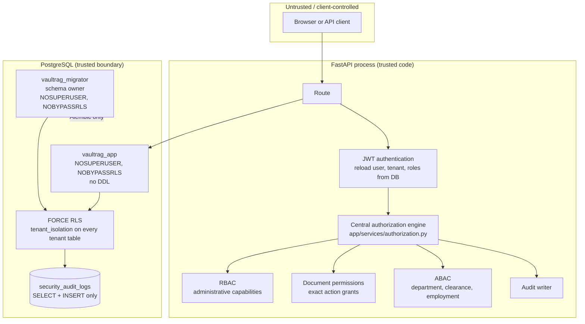

# Security Design — VaultRAG Milestone 4

This document is the security design reference for VaultRAG Milestones 1-4:
centralized RBAC/ABAC authorization, document permissions, PostgreSQL row-level
security (RLS), permission revocation, the security audit log, permission-aware
retrieval, local Ollama generation and citation validation.

The README is the quick start. This file explains **why** the controls are
arranged the way they are and what each layer does — and does not — protect.

---

## 1. Scope and non-goals

Implemented:

- authentication and tenant-scoped identity;
- RBAC capabilities for administrative operations;
- exact-match document permissions for roles or individual users;
- ABAC attribute evaluation;
- PostgreSQL `ENABLE` + `FORCE ROW LEVEL SECURITY`;
- two restricted database roles with different privileges;
- immediate permission and role revocation;
- append-only security audit logging with request-ID correlation;
- secure PDF ingestion, token-aware chunking and local 384-dimensional
  embeddings stored in pgvector;
- three-stage permission-aware retrieval that never selects unauthorized chunk
  text for context;
- local Ollama generation with backend-generated source ids and citation
  validation;
- automated tests for all of the above.

Out of scope for this milestone:

- frontend and conversation persistence;
- background ingestion/generation workers;
- OCR for scanned PDFs;
- production load, recall and capacity testing;
- refresh tokens, MFA, email verification, password reset or invitations;
- external identity providers;
- independent penetration testing.

---

## 2. Security control map



Key idea: **the application makes an authorization decision, and PostgreSQL
independently enforces tenant isolation.** A bug in one layer must not be enough
to cross a tenant boundary.

---

## 3. Four controls that are often confused

| Control | Question it answers | Scope | Where implemented |
|---|---|---|---|
| **RBAC** | May this user perform this administrative action? | Tenant, role-level | `app/services/rbac.py` |
| **Document permissions** | May this user or role perform this exact action on this document? | One document per grant | `app/services/document_permissions.py` |
| **ABAC** | Does this user's current context satisfy the document's policy? | Per request, attribute-driven | `app/services/abac.py` |
| **RLS** | May this database role see or write this tenant's row at all? | Every tenant table, every query | PostgreSQL policies |
| **Authorization engine** | What is the final decision, and how is it audited? | All document actions | `app/services/authorization.py` |

They are deliberately independent:

- RBAC does **not** grant document content access to non-admin roles.
- A document permission does **not** grant tenant administration.
- ABAC is evaluated **after** RBAC/document permissions and can only deny
  further; it never grants access by itself.
- RLS applies even if the application forgets a `WHERE tenant_id = ...` filter.
- The engine is the only place that combines these signals and records the
  decision.

---

## 4. Trust model and request lifecycle

The JWT proves that a token was signed by this service. It does **not** prove
that the user is still active, still belongs to the tenant, still holds the roles
in the token, or still has the claimed attributes.

Every protected request:

1. Extracts the bearer token.
2. Verifies signature, expiry and required claims.
3. Loads the user by `sub` from PostgreSQL.
4. Rejects the token if its `tenant_id` claim differs from the user row.
5. Checks user and organization `is_active`.
6. Reloads current roles from `user_roles` / `roles`.
7. Sets transaction-local RLS context to the trusted tenant.
8. Builds a frozen `AuthenticatedContext`.

Tenant identity is always derived from the **JWT claim plus the database user
row**, never from a query parameter, request body or custom header. The
pre-authentication tenant passed to `/auth/login` is only a selector used to
find the account; it is not trusted for any later authorization decision.

Consequences:

- Deactivating a user invalidates existing tokens immediately.
- Revoking a role takes effect on the next request.
- A stale `roles` claim in the JWT is ignored.
- The client cannot choose a tenant by editing a request.

---

## 5. Tenant isolation in depth

Isolation exists at five levels:

1. **Authentication context** — tenant comes from the verified token and the
   database row.
2. **Application query filters** — services filter by `tenant_id` explicitly.
3. **Composite foreign keys** — child rows cannot reference a parent in a
   different tenant. Examples: `(tenant_id, document_id)`, `(tenant_id,
   user_id)`, `(tenant_id, role_id)`.
4. **PostgreSQL RLS** — `tenant_isolation` policies deny rows outside
   `security.current_tenant_id()`.
5. **Audit trail** — every allow/deny decision records the tenant and actor.

Cross-tenant identifiers return **404**, not 403, so endpoints cannot be used to
enumerate the existence of another tenant's resources.

---

## 6. Database roles and privileges

Two login roles are used in development and production:

| Role | Purpose | Superuser | BYPASSRLS | DDL |
|---|---|---|---|---|
| `vaultrag_app` | Runtime API connection | no | no | no |
| `vaultrag_migrator` | Alembic and schema ownership | no | no | yes (owner) |

The original `vaultrag` role is only a bootstrap/owner account used to create
databases and run `database/bootstrap_roles.sql`. It must not be used by the API.

### Runtime grants (`vaultrag_app`)

| Table | Privileges |
|---|---|
| `organizations` | `SELECT`, `INSERT` |
| `roles` | `SELECT`, `INSERT` |
| `users` | `SELECT`, `INSERT`, `UPDATE` |
| `user_roles` | `SELECT`, `INSERT`, `DELETE` |
| `documents` | `SELECT`, `INSERT`, `UPDATE` |
| `document_permissions` | `SELECT`, `INSERT`, `UPDATE` |
| `user_attributes` | `SELECT`, `INSERT`, `UPDATE` |
| `security_audit_logs` | `SELECT`, `INSERT` |

Notable omissions:

- no `DELETE` on documents (documents are deactivated, not hard-deleted);
- no `UPDATE` or `DELETE` on audit logs (append-only);
- no `UPDATE` on organizations (tenant lifecycle is an operator action);
- no `CREATE` on schema `public`;
- no `CREATE` on the database;
- no table ownership.

The runtime role can use schema `security` and execute
`security.current_tenant_id()`, but cannot create or replace it.

---

## 7. PostgreSQL row-level security

Every tenant-owned table has:

```sql
ALTER TABLE <table> ENABLE ROW LEVEL SECURITY;
ALTER TABLE <table> FORCE ROW LEVEL SECURITY;

CREATE POLICY tenant_isolation ON <table>
AS PERMISSIVE
FOR ALL
TO PUBLIC
USING (
    security.current_tenant_id() IS NOT NULL
    AND tenant_id = security.current_tenant_id()
)
WITH CHECK (
    security.current_tenant_id() IS NOT NULL
    AND tenant_id = security.current_tenant_id()
);
```

Tables covered:

`organizations`, `roles`, `users`, `user_roles`, `documents`,
`document_permissions`, `user_attributes`, `security_audit_logs`.

Why `FORCE` and `TO PUBLIC`:

- `FORCE` applies the policy to the table owner too. The migrator owns the
  tables, so a data migration cannot accidentally bypass RLS.
- `TO PUBLIC` avoids accidentally exempting a future role.
- Only a superuser or a role with `BYPASSRLS` can bypass these policies. Neither
  application role has either attribute.

### Tenant context function

```sql
CREATE OR REPLACE FUNCTION security.current_tenant_id()
RETURNS uuid
LANGUAGE plpgsql
STABLE
PARALLEL SAFE
AS $$
BEGIN
    RETURN NULLIF(
        current_setting('app.current_tenant_id', true),
        ''
    )::uuid;
EXCEPTION
    WHEN invalid_text_representation THEN
        RETURN NULL;
END;
$$;
```

- Missing setting → `NULL`.
- Empty string → `NULL`.
- Malformed UUID → `NULL`.
- `NULL` context makes the policy predicate false, so **all tenant rows are
  denied**.

### Transaction-local context

The API sets the context with:

```sql
SELECT set_config('app.current_tenant_id', :tenant_id, true);
```

The third argument `true` makes it transaction-local. It is cleared on commit or
rollback, so a pooled connection cannot leak tenant A's context to tenant B's
next request.

The request boundary also matters:

- `get_db` owns the transaction and commits exactly once after the route
  succeeds.
- Services call `flush()`, not `commit()`. A nested commit would clear the
  transaction-local setting mid-request.
- Any exception rolls back, which clears the context before the connection is
  returned to the pool.

The test suite explicitly covers commit, rollback and pooled-connection reuse.

### Data migrations and bootstrap

Because the migrator is also subject to RLS, migrations that read or write
tenant rows must set the context first. Schema DDL is unaffected. Bootstrap
flows that create a new tenant switch the context to the new tenant ID before
inserting dependent rows.

---

## 8. Central authorization engine

Every document operation flows through `app/services/authorization.py`. Routes
do not query `document_permissions` or compare clearance levels directly.

Decision order:

1. **Action validation** — must be `READ`, `UPDATE`, `DELETE` or
   `MANAGE_PERMISSIONS`.
2. **Identity** — user must be active.
3. **Organization** — organization must be active.
4. **Tenant** — document tenant must equal the trusted context tenant.
5. **Document state** — inactive documents are denied.
6. **RBAC / document permission**:
   - `ADMIN` has an implicit tenant-wide document capability for all four
     actions;
   - every other role needs an exact active `document_permissions` row for the
     requested action.
7. **ABAC**:
   - required attributes must exist and be valid;
   - employment status must be `ACTIVE`;
   - department must match unless `cross_department_allowed` or the caller is
     `ADMIN`;
   - clearance must meet the document requirement.

The engine returns a decision containing the final policy identifier and reason.
`enforce_authorization` records the decision and raises `404` for a missing
tenant-scoped resource or `403` for a denied action.

### Why ADMIN still goes through ABAC

ADMIN can manage documents tenant-wide, including across departments, but
clearance and employment are still enforced. This prevents a compromised admin
account from reading `RESTRICTED` material above its clearance. Bootstrap of a
new admin therefore requires a second admin or an operator database session; an
admin cannot raise their own clearance.

---

## 9. Document permissions

A grant has exactly one subject, enforced by a database check constraint:

```sql
num_nonnulls(role_id, user_id) = 1
```

Grant properties:

- `permission_type`: `READ`, `UPDATE`, `DELETE`, `MANAGE_PERMISSIONS`;
- `expires_at`: optional future timestamp;
- `cross_department_allowed`: explicit ABAC override;
- `granted_by`, `granted_at`;
- `is_active`, `revoked_at`, `revoked_by`.

Semantics:

- Types are **exact-match**. `MANAGE_PERMISSIONS` does not imply `READ`,
  `UPDATE` or `DELETE`.
- Active duplicates are blocked by partial unique indexes for role and user
  subjects.
- A permission can expire without being explicitly revoked.
- Revocation is soft: `is_active = false`, `revoked_at` is set, and the row is
  retained as history.
- Re-granting after revocation creates a new active row.
- The authorization engine reloads permissions on every request; there is no
  authorization cache.

The database also enforces `expires_at > granted_at` and
`is_active OR revoked_at IS NOT NULL`, so a silent inactive grant is impossible.

---

## 10. ABAC attributes

Stored in `user_attributes` with a unique `(tenant_id, user_id,
attribute_name)` key.

Allowed attributes:

- `department`;
- `clearance_level` (`0`–`5`);
- `employment_status` (`ACTIVE`, `INACTIVE`, `SUSPENDED`, `TERMINATED`);
- `location`;
- `designation`.

Required for document access:

- `department`;
- `clearance_level`;
- `employment_status`.

Rules:

1. Missing required attribute → `ATTRIBUTE_VALIDATION_POLICY` deny.
2. Malformed value (including a corrupted database value) → deny.
3. Employment status other than `ACTIVE` → `EMPLOYMENT_STATUS_POLICY` deny.
4. Department mismatch without override → `DEPARTMENT_POLICY` deny.
5. Clearance below requirement → `CLEARANCE_POLICY` deny.

Classification floors:

| Classification | Minimum clearance |
|---|---|
| `PUBLIC` | 0 |
| `INTERNAL` | 1 |
| `CONFIDENTIAL` | 3 |
| `RESTRICTED` | 4 |

A document cannot be created with a `required_clearance_level` below its
classification floor. The floor is applied by the service, not just the client.

Attribute reads are self-service or ADMIN. Attribute writes require
`MANAGE_ATTRIBUTES` and cannot target the caller's own `clearance_level`. The
database stores `updated_by` for attribution.

---

## 11. Security audit

`security_audit_logs` records:

- tenant, actor, resource type and ID;
- action and decision (`ALLOW` / `DENY`);
- human-readable reason;
- policy identifier;
- request ID and client IP;
- server timestamp.

### Transaction rules

- **Allowed** decisions are written in the same transaction as the business
  action. If the audit insert fails, the whole request rolls back. This is the
  fail-closed rule: a security action must not succeed without its audit record.
- **Denied** decisions use an independent session and commit immediately. The
  request transaction is about to be rolled back, so using the request session
  would discard the denial.
- Reading the audit log is itself audited.

### Append-only enforcement

The runtime role has only `SELECT` and `INSERT` on the audit table. It cannot
update or delete rows. In addition, all audit reads and writes go through RLS,
so one tenant cannot see another tenant's audit trail.

Cross-tenant admin attempts (for example, changing a foreign user's status or
roles) return 404, do not mutate the foreign tenant, and are recorded as `DENY`
in the **actor's** audit trail.

---

## 12. Error handling and information leakage

- Missing or invalid credentials → `401`.
- Authenticated but not allowed → `403`, except cross-tenant resources → `404`.
- Invalid input → `422` for schema validation, `400` for business-rule
  validation.
- Duplicate active grant or double revocation → `409`.
- Audit write failure → the request fails; the business transaction rolls back.

Responses do not reveal whether a cross-tenant user, document or permission
exists.

---

## 13. Test coverage map

| Security property | Test file |
|---|---|
| Role catalogue, capabilities, immediate role revocation | `test_rbac.py` |
| Attribute validation, clearance, department, employment, malformed DB values | `test_abac.py` |
| Exact-match grants, role/direct subjects, inactive documents, `MANAGE_PERMISSIONS` | `test_document_permissions.py` |
| Expiry, soft revocation, re-grant, cross-tenant revoke | `test_permission_revocation.py` |
| Allowed/denied audit rows, append-only, request ID, audit fail-closed | `test_security_audit.py` |
| `FORCE RLS`, owner access, no/wrong/malformed context, pooled connections, grants | `test_rls.py` |
| Cross-tenant users, documents, audit, admin actions and composite FKs | `test_tenant_isolation.py` |

The suite runs against the real restricted database roles and real RLS
policies, not mocks.

---

## 14. Operational notes

- Run `database/bootstrap_roles.sql` before `alembic upgrade head`. The RLS
  migration fails loudly if `vaultrag_app` is missing.
- Keep `DATABASE_URL` on `vaultrag_app` and `MIGRATION_DATABASE_URL` on
  `vaultrag_migrator`. Never point the API at the schema owner.
- Use strong, distinct passwords outside local development.
- When adding a new tenant-owned table:
  1. include `tenant_id` and a composite FK to `organizations`;
  2. add it to the RLS migration/table list;
  3. add explicit `vaultrag_app` grants;
  4. add tenant-isolation and audit tests.
- Do not grant `BYPASSRLS`, superuser or table ownership to the runtime role.
- If a data fix must run as the migrator, set
  `app.current_tenant_id` in the same transaction or use a superuser maintenance
  session with change control.

---

## 15. Known limitations

- No frontend, conversation persistence, streaming or background worker yet.
- Citation validation proves source-id validity, not factual correctness of every generated sentence.
- The HNSW index is global, not tenant-partitioned; multi-tenant recall and latency need production-corpus tuning.
- No refresh-token rotation, token revocation list or MFA. Local Nginx applies
  per-IP login/API rate limits; distributed deployments need a shared limiter
  or WAF.
- No public bootstrap endpoint for the first administrator's ABAC attributes;
  use a second admin or an operator session.
- The audit table is append-only for the runtime role, but a database owner or
  superuser can still alter it. Protect those credentials and ship audit rows to
  external storage for high-assurance environments.
- RLS protects tenant isolation, not row-level business permissions. Document
  authorization remains an application responsibility, backed by constraints.
- This project follows production patterns but has not been independently
  security-audited.
