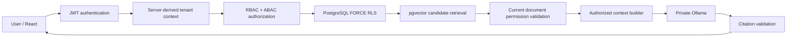

# VaultRAG system architecture

VaultRAG is an existing FastAPI, PostgreSQL/pgvector and React application. The API authenticates a bearer token, reloads the user and effective roles from PostgreSQL, binds tenant context in the current transaction, and uses both application authorization and forced RLS. Document chunks are filtered against current document and ABAC permissions before context is built. Citations are checked against the authorized retrieval set.

## Trust boundaries

- Browser input, uploaded PDFs, retrieved text, user questions and model output are untrusted.
- API identity is taken from signed JWT claims and checked against current database state; tenant identity is not accepted from a RAG request body.
- `vaultrag_app` is a non-owner, `NOBYPASSRLS` role; Alembic uses a separate `vaultrag_migrator` role.
- The Docker deployment publishes only the frontend proxy on loopback. PostgreSQL and Ollama have no host port mapping.
- Local uploaded files and Ollama model state use separate persistent volumes.

See [THREAT_MODEL.md](../security/THREAT_MODEL.md) for attacker scenarios and [DEPLOYMENT_GUIDE.md](../deployment/DEPLOYMENT_GUIDE.md) for service boundaries.
